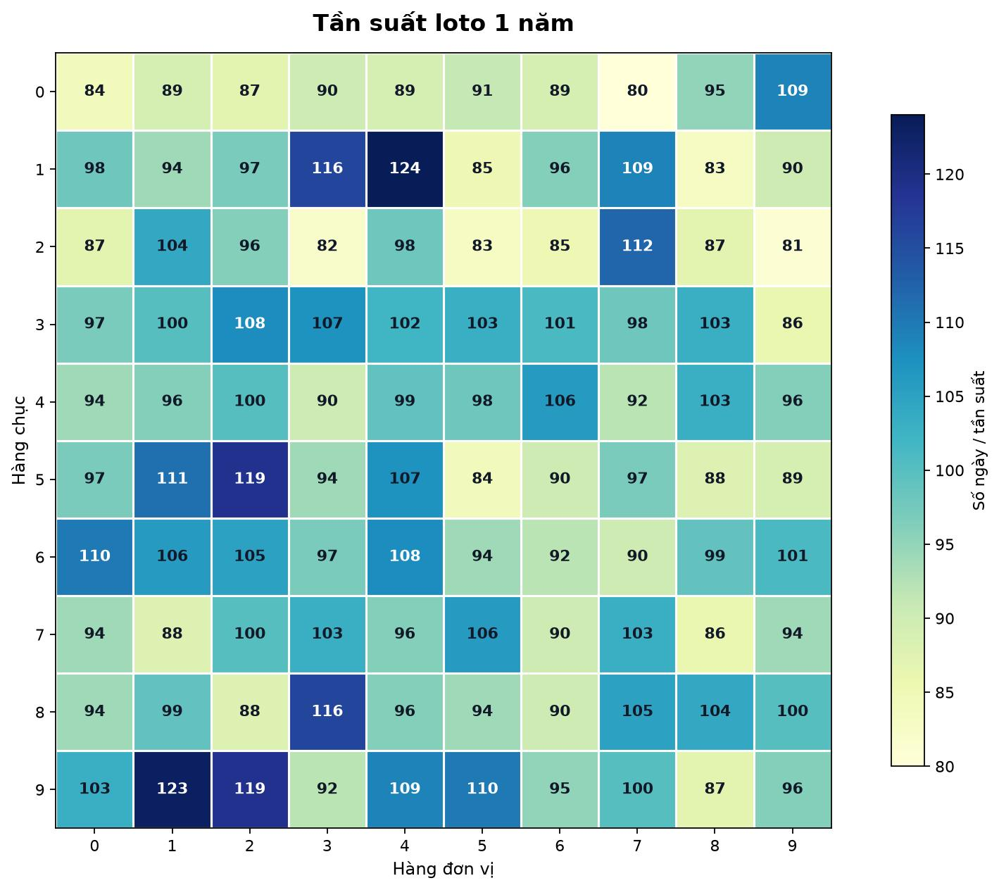
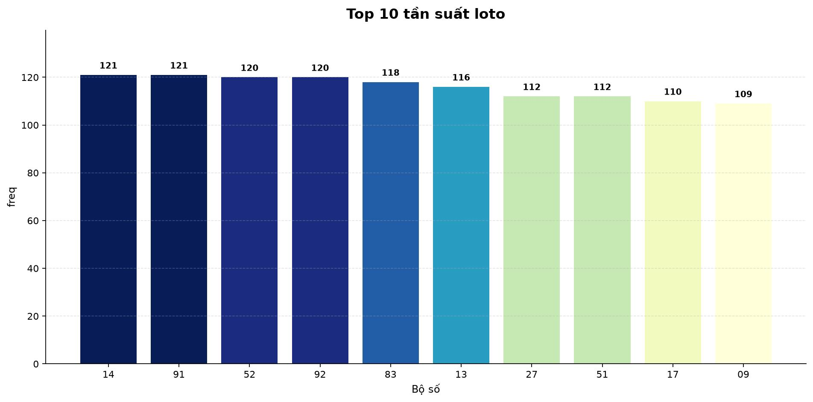
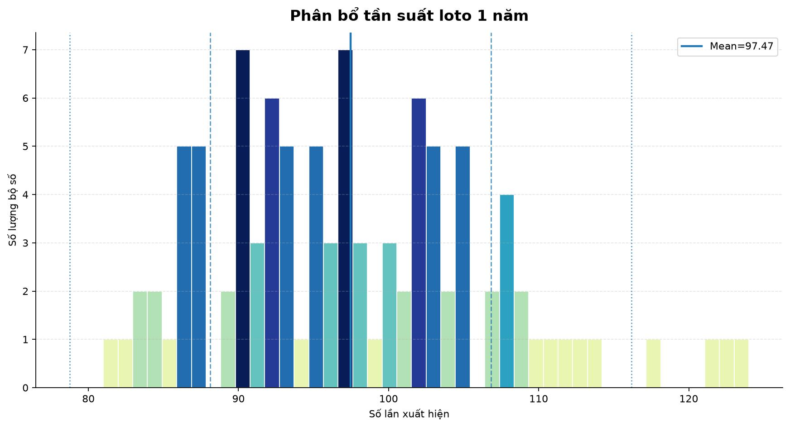

# Phân tích xổ số Việt Nam — bản vận hành hoàn toàn trên GitHub

Bộ mã nguồn vận hành hoàn toàn trên GitHub để tự động thu thập dữ liệu XSMB, xây dựng thống kê, chạy AI/ML, đánh giá mô hình và xuất bảng điều khiển tĩnh bằng **GitHub Actions + GitHub Pages**. Không cần máy chủ riêng hay dịch vụ nền chạy thường trực.

> Mục đích của hệ thống là phân tích dữ liệu lịch sử và nghiên cứu xác suất. Kết quả AI/ML là tín hiệu thống kê, không bảo đảm kết quả tương lai.

## Ảnh chụp dữ liệu mới nhất

<!-- SNAPSHOT:BEGIN -->
| Xổ số | LOTO |
| :------------: | :----------: |
| <table><tr><td>Ngày</td><td>30-10-2026</td></tr><tr><td>Giải Đặc Biệt</td><td>69259</td></tr><tr><td>Giải nhất</td><td>87081</td></tr><tr><td>Giải nhì</td><td>71863, 38253</td></tr><tr><td>Giải ba</td><td>08452, 03706, 11542, 49304, 76503, 19314</td></tr><tr><td>Giải tư</td><td>3423, 3537, 1570, 9612</td></tr><tr><td>Giải năm</td><td>8560, 8247, 2833, 8165, 5171, 6275</td></tr><tr><td>Giải sáu</td><td>857, 236, 824</td></tr><tr><td>Giải bảy</td><td>94, 77, 48, 25</td></tr></table> | <table><tr><td>Đầu</td><td>Đuôi</td></tr><tr><td>0</td><td>6, 4, 3</td></tr><tr><td>1</td><td>4, 2</td></tr><tr><td>2</td><td>3, 4, 5</td></tr><tr><td>3</td><td>7, 3, 6</td></tr><tr><td>4</td><td>2, 7, 8</td></tr><tr><td>5</td><td>9, 3, 2, 7</td></tr><tr><td>6</td><td>3, 0, 5</td></tr><tr><td>7</td><td>0, 1, 5, 7</td></tr><tr><td>8</td><td>1</td></tr><tr><td>9</td><td>4</td></tr></table> |
<!-- SNAPSHOT:END -->

<!-- FUN_PREDICTION:BEGIN -->
## 🎲 Dự đoán vui ngày 31-10-2026

> **Ngày neo:** kết quả thực đến **30-10-2026**. **Không phải kết quả thật.** Dự đoán vui/mô phỏng để tham khảo. Mô hình chỉ ước lượng xác suất 2 số cuối; các chữ số tiền tố trong bảng giải đầy đủ là số tổng hợp tất định, không phải xác suất dự đoán giải 3–5 chữ số và không bảo đảm kết quả thực tế.

### Bảng mô phỏng đầy đủ

| Giải | Dự đoán vui |
|---|---|
| Đặc Biệt | `89459` |
| Giải nhất | `72111` |
| Giải nhì | `39246` · `24642` |
| Giải ba | `61497` · `66217` · `01520` · `93864` · `53179` · `01123` |
| Giải tư | `7738` · `8944` · `9944` · `9520` |
| Giải năm | `5374` · `6201` · `7140` · `3424` · `0586` · `3793` |
| Giải sáu | `109` · `929` · `564` |
| Giải bảy | `27` · `70` · `57` · `07` |

### LOTO đứng đầu cho ngày mai

| # | Số | Xác suất mô hình |
|---:|:---:|---:|
| 1 | **75** | **23.78%** |
| 2 | **59** | **23.78%** |
| 3 | **37** | **23.78%** |
| 4 | **53** | **23.78%** |
| 5 | **63** | **23.77%** |
| 6 | **70** | **23.77%** |
| 7 | **52** | **23.77%** |
| 8 | **95** | **23.77%** |
| 9 | **14** | **23.77%** |
| 10 | **35** | **23.77%** |

### Đặc Biệt đứng đầu cho ngày mai

| # | Số | Xác suất mô hình |
|---:|:---:|---:|
| 1 | **54** | **1.041%** |
| 2 | **38** | **1.038%** |
| 3 | **32** | **1.031%** |
| 4 | **51** | **1.030%** |
| 5 | **42** | **1.028%** |
| 6 | **83** | **1.026%** |
| 7 | **21** | **1.022%** |
| 8 | **67** | **1.021%** |
| 9 | **39** | **1.021%** |
| 10 | **22** | **1.020%** |

> Xác suất ở bảng LOTO là xác suất mô hình cho số 00–99 xuất hiện trong kỳ; xác suất Đặc Biệt là phân phối riêng cho 2 số cuối giải Đặc Biệt. Các chữ số tiền tố trong bảng mô phỏng đầy đủ được sinh tất định để tạo bảng vui, không phải dự báo xác suất cho toàn bộ số 3–5 chữ số.
<!-- FUN_PREDICTION:END -->

## Kiến trúc vận hành

### Nguồn dữ liệu theo thứ tự ưu tiên

1. Nguồn chính: `xoso.com.vn`.
2. Dự phòng theo thứ tự ưu tiên: `mketqua.net`, rồi `www.minhngoc.net.vn`.

Theo chính sách từ 13-10-2026, chỉ gọi dự phòng khi nguồn chính gặp sự cố: không bóc được giá trị nào, hoặc từ **18:40 giờ Việt Nam** của kỳ quay mà vẫn thiếu ô (`sources.primary_has_failed`). Thiếu ô trong lúc quay trước mốc này là bình thường. Khi nguồn chính gặp sự cố, chỉ dữ liệu dự phòng được hợp nhất; nguồn chính không tham gia biểu quyết.

Hệ thống chỉ nhận số ASCII đúng độ dài từng giải và chỉ ghi kết quả mới vào lịch sử chuẩn khi đủ **27 ô được xác minh**, với ngưỡng **ít nhất 1 nhóm nhà cung cấp** cho mỗi ô. Nếu hai dự phòng trả số khác nhau ở cùng ô thì đó là thế hòa: số ưu tiên có thể hiện tạm thời nhưng ô ấy chưa được xác minh. Trang mà mọi giá trị trùng đúng ô của kỳ đã lưu gần nhất bị loại là dữ liệu cũ (`StalePage`), không được dùng để xác minh kỳ mới.

Dữ liệu trực tiếp là tạm thời và được giữ tách biệt khỏi lịch sử chuẩn cho tới khi đủ điều kiện xác minh.

## Chức năng chính

- Thu thập đa nguồn, thử lại, kiểm toán nguồn và cổng sức khỏe dữ liệu.
- XSMB gần thời gian thực bằng GitHub Actions: thăm dò nguồn chính, chỉ gọi hai dự phòng khi nguồn chính gặp sự cố, hợp nhất từng ô giải và cập nhật JSON trực tiếp khi dữ liệu thay đổi.
- Bộ phân tích cú pháp nghiêm ngặt: không chèn số 0 vào chỗ trống hoặc số đang quay chưa đủ độ dài.
- Thống kê tần suất, gan, chu kỳ, nháy, đầu/đuôi/tổng, chạm, cặp lộn, lô rơi, ma trận ngày/tuần/tháng/năm.
- Kiểm định thống kê với co Bayes, khoảng tin cậy, kiểm soát nhiều phép thử/FDR và chẩn đoán entropy/dịch chuyển.
- Tín hiệu Bayes thực nghiệm độc lập: suy giảm hàm mũ, hậu nghiệm theo thứ, ổn định đa cửa sổ và co về nền khi tín hiệu không ổn định.
- Bộ máy đường cầu theo vị trí chữ số, chuỗi đang chạy/ổn định, kiểm định cuốn chiếu và bằng chứng vị trí có thể giải thích.
- ML nền với đặc trưng thời gian: thứ của ngày mục tiêu, EWM 14/45, cửa sổ 7/30/90/365, xu hướng, gan/chuỗi, động lực số đảo và mức hỗ trợ đường cầu được vector hóa.
- Chọn mô hình theo thời gian qua 4 tầng: huấn luyện → hiệu chỉnh theo tỷ lệ tự nhiên → chọn mô hình → kiểm định chưa chạm.
- `HistGradientBoostingClassifier` + hiệu chỉnh Platt + trọng số gần đây; mô hình yếu được co về nền lịch sử thay vì phát xác suất quá tự tin.
- Cầu-kèo ML + bằng chứng vị trí.
- Mô hình tổ hợp 5 thành phần: ML nền + cầu-kèo ML + Bayes thống kê + cầu đang chạy + cầu ổn định; trọng số học bằng LogLoss cuốn chiếu có điều chuẩn.
- Mức bất đồng/bất định của mô hình, LogLoss/Brier cuốn chiếu và lịch sử dự báo gọn.
- Bảng điều khiển thích ứng trong `docs/`, triển khai trực tiếp bằng GitHub Pages Actions.
- Tệp xuất an toàn cho Excel, giữ số 0 ở đầu.

## Cài đặt mới hoàn toàn trên GitHub

### 1. Tạo kho mã nguồn

Tạo kho mã nguồn GitHub mới và tải **toàn bộ nội dung gói vào thư mục gốc của kho**.

Khuyến nghị để kho ở chế độ riêng tư trong giai đoạn thử nghiệm; chỉ đổi quyền hiển thị khi Pages và truy cập công khai đã đúng.

### 2. Cho phép GitHub Actions ghi dữ liệu

Vào:

`Settings → Actions → General → Workflow permissions`

Chọn:

`Read and write permissions` (quyền đọc và ghi)

rồi bấm Lưu.

### 3. Bật GitHub Pages bằng GitHub Actions

Vào:

`Settings → Pages → Build and deployment`

Chọn:

`Source: GitHub Actions` (nguồn: GitHub Actions)

Không chọn `Deploy from a branch`; gói đã có quy trình Pages chính thức trong `.github/workflows/pages.yml`.

### 4. Chạy hoàn tất dữ liệu lần đầu

Vào:

`Actions → Hoàn tất XSMB, thống kê và AI/ML → Run workflow`

Lần chạy đầu sẽ:

1. Nạp lịch sử đã ghi nhận.
2. Đồng bộ ngày thiếu theo chính sách một nguồn chính và hai dự phòng.
3. Chỉ đưa kết quả mới vào dữ liệu chuẩn khi vượt cổng kiểm định/đồng thuận.
4. Chạy thống kê và kiểm định.
5. Khớp lại đường cầu.
6. Huấn luyện lại ML nền nếu có kỳ quay mới hoặc lược đồ đặc trưng thay đổi.
7. Chạy cầu-kèo ML và tín hiệu Bayes thực nghiệm.
8. Ghi lịch sử dự báo và cập nhật nhãn.
9. Học trọng số/hiệu chỉnh mô hình tổ hợp khi lịch sử đủ trưởng thành.
10. Dựng bảng điều khiển.
11. Ghi nhận `data/`, `models/`, `images/`, `docs/`, `README.md`.
12. Triển khai trực tiếp `docs/` lên GitHub Pages.

Không cần bí mật GitHub trong cấu hình mặc định.

## XSMB gần thời gian thực

Workflow:

`Kết quả XSMB gần thời gian thực`

được lập lịch lúc **18:00 Asia/Ho_Chi_Minh (UTC+7)**. Một tiến trình chạy trong cửa sổ quay và thăm dò khoảng **15 giây/lần** trong tối đa 60 phút. Mỗi ảnh chụp hỏi nguồn chính trước; hai dự phòng chỉ được gọi khi nguồn chính không trả giá trị nào hoặc từ 18:40 vẫn thiếu ô. Chỉ dữ liệu thay đổi mới được buộc xuất bản thành `live/live.json` trên nhánh `live`.

`docs/live.html` đọc JSON gốc từ nhánh `live`, vì vậy không phải dựng lại toàn bộ GitHub Pages mỗi lần có thêm một giải.

Các trạng thái trực tiếp:

- `waiting`: đang chờ, chưa có giá trị.
- `live`: đang có kết quả từng phần.
- `complete_provisional`: đủ 27 giá trị nhưng chưa đủ điều kiện xác minh toàn bộ ô.
- `complete_conflict`: đã đủ nhưng các nguồn còn xung đột.
- `complete_verified`: toàn bộ 27 ô đã được xác minh; tác vụ trực tiếp có thể dừng.

Nếu kho dùng bảo vệ nhánh, **không áp dụng quy tắc cấm đẩy cưỡng bức cho nhánh `live`**, hoặc loại nhánh này khỏi quy tắc. `main` không bị đẩy cưỡng bức.

> Quy trình GitHub theo lịch có thể bị nền tảng trì hoãn. Vì vậy kiến trúc chỉ dùng GitHub không thể cam kết thời gian thực tuyệt đối như máy chủ luôn chạy. Thiết kế này giảm rủi ro bằng cách mở tác vụ trực tiếp trước giờ quay, thăm dò trong tác vụ và có nhiều mốc hoàn tất/phục hồi sau quay.

## Lịch hoàn tất dữ liệu hằng ngày

Timezone: `Asia/Ho_Chi_Minh`.

- `18:30, 18:40, 18:50, 19:00, 19:10, 19:20, 19:30, 19:45, 20:00` — hoàn tất và phục hồi dữ liệu chuẩn.

Bộ gác kiểm tra ngày dữ liệu chuẩn trước khi chạy; nếu kỳ hôm nay đã được ghi thành công, các lượt phục hồi không làm gì thêm. Có thể bấm `Run workflow` để chạy thủ công bất kỳ lúc nào.

<!-- AUTOMATION:BEGIN -->
## ⚙️ Tự động hóa không cần can thiệp

Hệ thống vận hành tự động bằng GitHub Actions; không cần chạy cron/VPS bên ngoài trong cấu hình mặc định.

| Lớp tự động | Giờ Việt Nam | Hành vi |
|---|---|---|
| Gần thời gian thực chính | **18:00** | Mở cửa sổ trực tiếp trước giờ quay, thăm dò khoảng 15 giây/lần từ nguồn chính; chỉ gọi dự phòng khi nguồn chính gặp sự cố. |
| Bộ giám sát trực tiếp | **17:55, 18:05, 18:15, 18:25, 18:45** | Nếu dữ liệu trực tiếp chưa có nhịp báo của ngày hiện tại, tự gọi lại quy trình trực tiếp. |
| Hoàn tất hằng ngày | **18:30, 18:40, 18:50, 19:00, 19:10, 19:20, 19:30, 19:45, 20:00** | Thăm dò/tải theo chính sách một nguồn chính và hai dự phòng, yêu cầu ≥1 nhóm nhà cung cấp cho mỗi ô và không có thế hòa, ghi dữ liệu chuẩn trước rồi mới chạy thống kê + AI/ML + dự báo + README + Pages. |
| Phục hồi dữ liệu chuẩn | **19:05, 19:25, 19:45, 20:05** | Nếu dữ liệu chuẩn còn cũ hoặc kiểm toán artifact không đạt, tự gọi lại quy trình hoàn tất hằng ngày. |
| Phục hồi Pages | **20:10–20:35** | Thử lại việc triển khai Pages độc lập khi dữ liệu chuẩn đã ổn. |
| Lưới an toàn qua đêm | **07:15** | Kiểm tra lại dữ liệu chuẩn, dự báo, README, artifact mô hình, bảng điều khiển và đối soát dữ liệu trực tiếp. |
| Hậu kiểm hoàn tất | Sau mỗi lượt hằng ngày thành công | Kiểm toán vận hành đầy đủ và đồng bộ nhánh `live` về đúng dữ liệu chuẩn `complete_verified`. |

Các quy trình phục hồi kiểm tra trạng thái trước khi gọi để tránh tạo tác vụ trùng khi quy trình mục tiêu đang `queued/in_progress`. Việc ghi dữ liệu chuẩn hằng ngày vẫn độc lập với Pages/bộ giám sát, nên lỗi bảng điều khiển hoặc hậu kiểm không giữ lại kết quả hằng ngày đã xác minh.

> Quy trình GitHub theo lịch hoạt động theo khả năng tốt nhất và nguồn dữ liệu bên thứ ba có thể thay đổi/gián đoạn. Bộ giám sát cùng nhiều mốc phục hồi giúp hệ thống tự phục hồi tối đa trong giới hạn kiến trúc chỉ dùng GitHub, nhưng không thể tạo SLA tuyệt đối như bộ lập lịch/máy chủ chuyên dụng.
<!-- AUTOMATION:END -->

## Bảng điều khiển

- `docs/index.html` — trang tổng hợp/bảng điều khiển chính.
- `docs/live.html` — kết quả gần thời gian thực và xác minh nguồn.
- `docs/statistics.html` — thống kê/ma trận nâng cao.
- `docs/dashboard.html` — bảng điều khiển mô hình tổ hợp AI/ML.
- `docs/model-quality.html` — LogLoss/Brier cuốn chiếu.
- `docs/ml_top10_loto.html`, `docs/ml_top10_de.html`.
- `docs/soi-path-loto-active.html`, `docs/soi-path-loto-stable.html`.
- `docs/soi-path-de-active.html`, `docs/soi-path-de-stable.html`.

## Dữ liệu đầu ra

| Bộ dữ liệu | CSV | JSON | XLSX an toàn cho Excel |
|---|---|---|---|
| Kết quả gốc | `data/xsmb.csv` | `data/xsmb.json` | `data/excel/xsmb.xlsx` |
| Hai chữ số | `data/xsmb-2-digits.csv` | `data/xsmb-2-digits.json` | `data/excel/xsmb-2-digits.xlsx` |
| Thưa 00–99 | `data/xsmb-sparse.csv` | `data/xsmb-sparse.json` | `data/excel/xsmb-sparse.xlsx` |

Dữ liệu dẫn xuất:

- `data/source_audit.json` — nguồn gốc/đồng thuận gần đây.
- `data/stats/advanced/` — thống kê nâng cao.
- `data/stats/significance/` — kiểm định/FDR/chẩn đoán.
- `data/stats/statistical_signal/` — thành phần Bayes thực nghiệm.
- `data/soi_cau/path_ui/` — đầu ra đường cầu đang chạy/ổn định.
- `data/ai_ml/` — cầu-kèo ML/evidence.
- `data/ml/` — xác suất ML nền đã hiệu chỉnh.
- `data/ensemble/` — trọng số/hiệu chỉnh mô hình tổ hợp đã học.
- `data/forecast/predict/` — xác suất và danh sách chọn cuối của mô hình tổ hợp.
- `data/evaluation/history/` — lịch sử thành phần cuốn chiếu gọn.
- `data/evaluation/prob_eval/` — chỉ số chất lượng mô hình cuốn chiếu.
- `models/` — artifact mô hình đã huấn luyện + báo cáo huấn luyện.

## Thống kê 1 năm hiện tại

- Tần suất lớn nhất: **124.0**
- Tần suất nhỏ nhất: **81.0**
- Trung bình: **97.47**
- Độ lệch chuẩn: **9.35**







## Kiểm tra chất lượng code

CI chạy khi đẩy mã hoặc mở yêu cầu hợp nhất. Có thể nghiệm thu tương đương trên máy phát triển:

```bash
python -m pip install -r requirements-dev.txt
bash scripts/release/release_check.sh
```

Kiểm tra phát hành xác minh cú pháp/phân tích tĩnh, kiểm thử đơn vị, chính sách nguồn, thử nhanh huấn luyện/dự báo, thống kê Bayes, tính toàn vẹn dữ liệu và các đầu ra bắt buộc từ dữ liệu đã ghi nhận.

## Cấu trúc repository

```text
.github/workflows/   CI, kết quả trực tiếp, hoàn tất hằng ngày, triển khai Pages
src/                 mã nguồn: nguồn dữ liệu, thống kê, AI/ML, trình dựng trang
src/web/templates/       mẫu HTML/CSS/JS và mẫu README
src/web/assets/          tài nguyên trang (JS, phông, biểu tượng)
tests/               kiểm thử Python; tests/frontend/ kiểm thử Node
data/                sổ chuẩn (xsmb*, regions/, excel/) ở gốc; đầu ra phân tích theo gói sinh ra chúng
data/stats/          thống kê mô tả, kiểm định, Markov, chu kỳ, cặp
data/soi_cau/        cầu vị trí, bảy kiểu cầu, cầu theo đường
data/forecast/       dự báo đã công bố, học trực tuyến, kho tri thức, Lô VIP, ba tác tử
data/evaluation/     sổ dự báo, chất lượng mô hình, độ tin cậy, sổ mô phỏng, sổ phỏng đoán
data/research/       phép đo nghiên cứu và giả thuyết tiến cứu đã đăng ký
models/              mô hình đã huấn luyện
images/              biểu đồ đã tạo
docs/                CHỈ trang web tĩnh GitHub Pages
documentation/       tài liệu viết tay: kiến trúc, vận hành, nghiên cứu, QA, kế hoạch, giao diện
scripts/release/     bốn kịch bản chốt phát hành
scripts/browser/     kiểm tra giao diện bằng trình duyệt thật
scripts/ops/         vận hành, bảo trì (điều hướng, CSS tới hạn, bộ đệm, đúng giờ)
scripts/research/    tái lập các phép đo nghiên cứu
scripts/reference/   đọc trang tham chiếu qua runner Actions
vietlott/            engine Vietlott, dự án tự đủ chạy riêng
worker/              Cloudflare Worker cho kết quả trực tiếp
config/              bảng thuật ngữ số
requirements*.txt    phụ thuộc theo môi trường (cơ bản, phát triển, trực tiếp, ML)
```

## Ghi chú về xác suất

Xổ số là quá trình ngẫu nhiên; thêm nhiều thuật toán không biến dữ liệu lịch sử thành bảo đảm dự đoán. Hệ thống ưu tiên hiệu chỉnh, kiểm định ngoài mẫu, co ước lượng và bất đồng mô hình để **giảm khớp quá mức và tự tin quá mức**, thay vì phóng đại tín hiệu yếu.

## Giấy phép

Xem `LICENSE` trong kho mã nguồn.