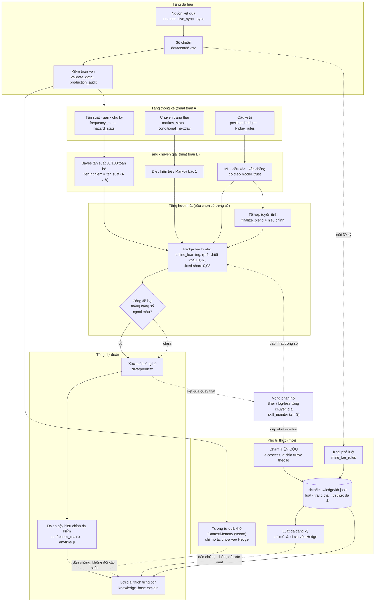

# Hệ suy luận, tri thức và tự học — kiến trúc tổng thể

Ngày 13-10-2026. Đây là câu trả lời cho yêu cầu thiết kế "hệ thuật toán phân tích, suy luận và tự học". Yêu cầu có bốn phần:

1. Liên kết các thuật toán và bầu chọn có trọng số.
2. Tự tìm và bổ sung tri thức.
3. Tự học, tự tối ưu trọng số.
4. Suy luận Bayes/Markov kèm độ tin cậy và lời giải thích.

Ba phần đã có trong kho và đang chạy hằng ngày. Phần 2 chưa có, nay được bổ sung bằng `src/forecast/knowledge_base.py`.

## 0. Nguyên tắc trước khi đọc sơ đồ

**Máy quay công bằng không có quy luật nào để học.** Mọi phép đo của kho đều ra cùng một kết quả:

| Ngày đo | Phép đo | Kết quả |
|---|---|---|
| 03-10 | Mô hình xác suất ba tầng | Không hơn dự báo hằng số |
| 04-10 | Tổ hợp | Kém hằng số cho tới khi sửa mức |
| 08-10, 12-10 | Lô nhiều nháy | Ngang chọn bừa |
| 13-10 | Cặp xiên 2 | Ngang chọn bừa |

Kiến trúc dưới đây vì thế được thiết kế để KHÔNG tự lừa mình:

- Mọi thành phần đều so với một đối chứng: dự báo hằng số (mức nền), hoặc chọn bừa trên cùng kỳ.
- Trọng số chỉ được tin khi thắng đối chứng ngoài mẫu.
- Một quy luật mới chỉ thành "tri thức" khi đứng vững trên các kỳ quay CHƯA tồn tại lúc nó được phát hiện.
- "Độ tin cậy" là trạng thái của một phép kiểm, không phải xác suất trúng.

## 1. Sơ đồ kiến trúc tổng thể



Ở cổng đề bạt, nhánh "có" công bố hỗn hợp Hedge trộn 50/50 với tổ hợp sản xuất; nhánh "chưa" công bố tổ hợp sản xuất và để Hedge chạy bóng mờ. Hôm nay cổng ở nhánh "chưa": mới chốt 15 kỳ, cổng cần ít nhất 60.

### Vòng tự học của một kỳ quay

```mermaid
sequenceDiagram
    participant P as Pipeline (trước 18:00)
    participant O as online_learning
    participant K as knowledge_base
    participant D as Kỳ quay 18:15
    P->>O: lịch sử đến hôm qua + tổ hợp sản xuất
    O->>O: chốt kỳ trước: Brier từng chuyên gia
    O->>O: slow += loss; fast = 0,97·fast + loss
    O->>O: w = ½·softmax(−η·slow) + ½·softmax(−η·fast), trộn fixed-share
    O->>O: hỗn hợp = Σ w·p; cổng đề bạt
    O-->>P: xác suất công bố + sổ (đóng băng trước giờ quay)
    P->>K: kho tri thức: chấm luật, ngữ cảnh, giải thích top-10
    D-->>P: kết quả thật
    Note over O,K: Lượt sau dùng kết quả này làm phản hồi.<br/>Không có gì được sửa sau giờ quay.
```

## 2. Đối chiếu bốn yêu cầu với mã

| Yêu cầu | Đã có (đang chạy) | Bổ sung ngày 13-10-2026 |
|---|---|---|
| 1a. Đầu ra A thành đầu vào B | Tần suất làm tiên nghiệm Beta cho hậu nghiệm Bayes (`online_learning.build_experts` → `_posterior`, độ co học bằng `fit_shrinkage_to_prior`); thành phần cầu-kèo và ML vào tổ hợp | Luật trễ khai phá từ thống kê đồng xuất hiện thành mục trong kho, vào lời giải thích |
| 1b. Ensembling / bầu chọn có trọng số | `ensemble_utils.finalize_blend` (tuyến tính, neo mức LOTO), `opinion_pool` (trộn log-odds có độ sắc học được), `meta_predictor` (xếp chồng có cổng), Hedge của `online_learning` | — |
| 2a. Tự quét, bóc tách, phân loại tri thức | Các giả thuyết đăng ký tay: `hot_tail_test`, `digit_sum_hypothesis` | `mine_lag_rules`: mỗi 30 kỳ khai phá 20 luật "a về → b về kỳ sau"; `measured_knowledge`: gom kết luận của mọi phép đo đã có; phân loại bằng trạng thái suy từ số đo |
| 2b. Kho tri thức rule-based + vector | — | `data/knowledge/kb.json` (luật, lô đăng ký, trạng thái, số đo); `ContextMemory`: vectơ ngữ cảnh 300 chiều, truy vấn cosine |
| 3a. Vòng phản hồi | `online_learning.advance` chấm Brier từng chuyên gia mỗi kỳ; `skill_monitor` chấm thứ ĐÃ công bố, báo động z = 3 | `score_rule` chấm luật trên kỳ mới mỗi ngày |
| 3b. Tự chỉnh trọng số ngắn/dài hạn | Hedge hai trí nhớ: dài hạn (tổng loss), ngắn hạn (chiết khấu 0,97, nửa đời ≈ 23 kỳ), fixed-share 0,03; `learn_ensemble_weights` có cổng ngoài mẫu so với MẶC ĐỊNH; `ml_engine.aggregation` (trọng số mũ trên log-loss, chia sẻ cố định, kèm cổng `model_trust`; phân hệ nghiên cứu, chưa nối vào pipeline — thay bandit Thompson từ 20-10-2026) | — |
| 4a. Bayes / Markov chuỗi sự kiện | `confidence_matrix` (Bayes, Markov, cầu), `markov_stats`, `conditional_nextday`, chuyên gia `lag_repeat` | — |
| 4b. Độ tin cậy + giải thích | Độ tin cậy ba tầng hiệu chỉnh trên 10 000 lịch sử công bằng; ngăn kéo bằng chứng trên mọi trang (`evidence_catalog`) | `knowledge_base.explain`: đóng góp từng chuyên gia, tầng tin cậy, luật đang bắn, ngữ cảnh tương tự, câu giải thích |

## 3. Chức năng từng module

### Tầng dữ liệu
- **`sources`, `live_sync`, `sync`**: một nguồn chính, hai nguồn dự phòng, chốt theo đồng thuận. Chặn trang còn hiện kỳ hôm qua.
- **`validate_data`, `production_audit`**: lịch liên tục, đủ 27 giải, không trùng.

### Tầng thống kê (thuật toán A)
- **`frequency_stats`, `hazard_stats`, `gap_cycle_stats`**: tần suất, độ gan, chu kỳ. Đây là đầu vào của tiên nghiệm.
- **`markov_stats`, `conditional_nextday`**: xác suất chuyển trạng thái giữa hai kỳ liên tiếp.
- **`position_bridges`, `bridge_rules`**: cầu vị trí theo luật trang tham chiếu.

### Tầng chuyên gia (thuật toán B)
- **Bayes tần suất** (`online_learning._posterior`): p = (đếm + κ·tiên nghiệm) / (số kỳ + κ). Độ co κ học từ dữ liệu, không đặt tay.
- **Điều kiện trễ** (`lag_special`, `lag_repeat`): Markov bậc 1, lấy chính hậu nghiệm toàn lịch sử làm tiên nghiệm.
- **ML, cầu-kèo, xếp chồng**: co về nền theo `model_trust = clip(20·s, 0, 1)`; không có kỹ năng thì bằng nền.
- **Tương tự quá khứ** (`ContextMemory`, mới):
  - Vectơ ngữ cảnh gồm ba khối 100 chiều: tần suất 30 kỳ, độ "nóng" exp(−gan/30) và kỳ trước. Mỗi khối chuẩn hoá chéo 100 con, rồi cả vectơ chuẩn hoá về độ dài 1.
  - Truy vấn 50 ngữ cảnh giống nhất bằng cosine. Bỏ 30 kỳ ngay trước, vì chúng "giống" chỉ do chung cửa sổ.
  - Dự báo là tỉ lệ con về ở kỳ ngay sau các ngữ cảnh ấy, co về nền bằng 50 kỳ ảo.

### Tầng hợp nhất
- **`finalize_blend`**: một phép chốt cho mọi nơi. Đặc Biệt có sàn đều; LOTO neo Σp = 23,77.
- **`opinion_pool`**: logit(p) = logit(p₀) + s·Σwᵢ·(logit pᵢ − logit p₀), với độ sắc s học được. s < 1 khi các nguồn chồng lấn.
- **`online_learning`**: Hedge với hai trí nhớ và cổng đề bạt. Chỉ công bố hỗn hợp khi nó thắng cả hằng số lẫn tổ hợp sản xuất, với cận dưới vượt 0.

### Tầng tin cậy và giải thích
- **`confidence_matrix`**: tin cậy của một thành phần là tỉ lệ lịch sử công bằng mà tín hiệu mạnh nhất của cả họ còn yếu hơn nó. Đây là hiệu chỉnh đa kiểm, không phải hậu nghiệm thô của một con.
- **`knowledge_base.explain`** (mới): xem mục 4.3.

### Kho tri thức (mới)
- **`mine_lag_rules`**:
  - Tính đồng xuất hiện trễ co[a, b] = số lần a về ở kỳ t−1 và b về ở kỳ t.
  - Tỉ lệ điều kiện được co Beta về tỉ lệ nền của b, với 100 lần quan sát ảo. Chỉ xét tiền đề a đã xảy ra ít nhất 200 lần.
  - Lấy 20 luật có lift cao nhất. Lịch sử không đủ thì đăng ký ít hơn, không bịa.
- **`score_rule`**: chấm luật CHỈ trên kỳ sau ngày đăng ký, tối đa 180 kỳ, bằng e-process một phía (xem 4.4).
- **`batch_alpha`**: lô thứ k được phần α·6/(π²k²) của α = 0,01, chia đều cho các luật trong lô. Tổng trên mọi lô bằng đúng α. Phần ấy ghi vào từng luật lúc đăng ký (`alpha`, `threshold_e`), nên lô mới không nâng ngưỡng của lô cũ và không rút lại kết luận đã báo. Ngưỡng N/α theo số luật hiện có thì lô k bị xét ở α/k, và tổng α·(1 + 1/2 + …) không bị chặn. Chỉ số k đếm tiếp qua các thí nghiệm đã nghỉ (`batches_spent`), nên đổi cấu hình không tiêu lại α.
- **`rule_status`**: `co-bang-chung` khi e-value đạt ngưỡng riêng của luật; `het-han` khi quá 180 kỳ mà chưa đạt; còn lại `dang-kiem`.
- **`measured_knowledge`**: gom kết luận đã đo ở nơi khác thành mục có trạng thái, gồm 15 họ của `confidence_matrix`, giả thuyết đuôi nóng, bộ lọc lô nhiều nháy, cặp xiên 2 và cổng tự học. Các họ của `confidence_matrix` là ẢNH CHỤP: p tính lại mỗi ngày trên lịch sử dồn, nên xem lại hằng ngày thì xác suất có lúc vượt ngưỡng lớn hơn α nhiều. Vì thế chúng không bao giờ là `co-bang-chung`; muốn thế phải đăng ký phép kiểm tiến cứu. Holm trên cả 15 họ chỉ để phân loại: qua Holm là `tin-hieu-anh-chup`, qua α riêng mà không qua Holm là `chua-co-bang-chung`.

## 4. Mã mẫu (trích từ mã đang chạy)

### 4.1. Truyền dữ liệu A → B: tần suất thành tiên nghiệm Bayes

```python
# online_learning.build_experts — đầu ra thống kê (đếm, số kỳ) là đầu vào của hậu nghiệm.
base = np.full(100, baseline_rate(mode))           # mức nền lý thuyết
y = _outcomes(mode, frame)                         # ma trận kỳ × con: con về hay không
for horizon in (30, 180, "all"):
    window = y if horizon == "all" else y[-horizon:]
    experts[f"bayes_{horizon}"] = _posterior(mode, window.sum(axis=0), len(window), base)
prior = experts["bayes_all"]                       # hậu nghiệm dài hạn làm tiên nghiệm cho...
experts["lag_repeat"] = _posterior(mode, (y[1:] * same_status).sum(axis=0),
                                   same_status.sum(axis=0), prior)   # ...chuyên gia Markov

def _posterior(mode, counts, trials, prior):
    kappa = fit_shrinkage_to_prior(counts, trials, prior)   # độ co HỌC từ dữ liệu
    return (counts + kappa * prior) / (trials + kappa)
```

### 4.2. Hàm tự cập nhật trọng số (vòng tự học)

```python
# online_learning.advance — chốt kỳ vừa quay, rồi cập nhật hai trí nhớ.
losses = np.array([brier(expert_probs[e], actual) for e in EXPERTS])   # phản hồi thật
learning["slow_loss"] = slow + losses                    # dài hạn: tổng toàn bộ
learning["fast_loss"] = 0.97 * fast + losses             # ngắn hạn: nửa đời ≈ 23 kỳ

def _weights(learning):                                  # Hedge (trọng số mũ)
    memories = []
    for name in ("slow_loss", "fast_loss"):
        logits = -ETA * np.asarray(learning[name])       # ETA = 4
        p = np.exp(logits - logits.max())
        memories.append(p / p.sum())
    p = (memories[0] + memories[1]) / 2                  # cân bằng ngắn hạn và dài hạn
    return (1 - 0.03) * p + 0.03 / len(EXPERTS)          # fixed-share: không chuyên gia nào chết hẳn

mixture = sum(w[i] * experts[e] for i, e in enumerate(EXPERTS))       # bầu chọn có trọng số
gate = promotion_gate(records)            # thắng cả hằng số lẫn sản xuất, cận dưới > 0?
published = blend if gate["active"] else experts["incumbent"]
```

Vì sao Hedge mà không phải "tăng trọng số cho ai đúng hôm qua"?

- Hedge có cận regret: với loss bị chặn và η phù hợp, tổng loss của hỗn hợp không vượt loss của chuyên gia tốt nhất quá O(√(T·ln N)), bất kể dữ liệu ra sao. Ở dạng đặc biệt dùng log-loss với η = 1, hỗn hợp chính là trung bình mô hình Bayes, cận còn ln N.
- Chuyên gia hằng số nằm trong tập chuyên gia, nên hỗn hợp không thể lâu dài tệ hơn hằng số quá cận ấy.
- Trí nhớ ngắn hạn và fixed-share cho phép bám theo khi chuyên gia tốt nhất thay đổi, kiểu "fixed-share" của Herbster–Warmuth.
- Bản đang chạy dùng Brier, η = 4, trung bình hai trí nhớ và fixed-share 0,03, nên không chép nguyên cận lý thuyết nào. Thứ bảo vệ thực tế là cổng đề bạt: hỗn hợp chỉ được công bố khi thắng cả hằng số lẫn sản xuất với cận dưới vượt 0.

### 4.3. Hàm dự đoán chuyên sâu kèm độ tin cậy và giải thích

```python
# knowledge_base.explain — một con số, mọi nguồn, đúng con số đã công bố.
def explain(number, mode, *, record, confidence_row, rules, analog):
    base = baseline_rate(mode)
    contributions = [
        {"expert": e, "weight": w[e], "prob": p[e][number],
         "delta": w[e] * (p[e][number] - base)}           # phần kéo hỗn hợp khỏi nền
        for e in record["experts"]]
    # bất biến (có phép kiểm): base + Σ delta == hỗn hợp Hedge của con ấy
    tier = confidence_row["tier"]                       # hiệu chỉnh đa kiểm, không phải hậu nghiệm thô
    firing = [r for r in rules if r["then"] == number]  # luật có tiền đề đã về hôm nay
    return {"probability": record["published"][number], "contributions": sorted_by_abs_delta,
            "confidence": tier, "rules": firing, "analog": analog, "reasons": [...]}
```

Kết quả thật cho con LOTO xếp đầu kỳ 13-10-2026, con **74**, từ `data/knowledge/kb.json`:

> - Xác suất đã công bố 23,82% so với mức nền 23,77% (×1,002).
> - Nguồn kéo mạnh nhất: Tổ hợp sản xuất (23,82%, trọng số 0,143).
> - Độ tin cậy Thấp / nhiễu (đã hiệu chỉnh đa kiểm trên 10 000 lịch sử công bằng).
> - Tự học trực tuyến đang ở chế độ bóng mờ: chưa thắng hằng số đủ chắc để được dùng.
> - Ngữ cảnh tương tự quá khứ: 12/50 kỳ giống nhất có con này về ở kỳ sau (nền 23,8%).

Lời giải thích nói thật: con xếp đầu chỉ cao hơn nền 0,2%, và không nguồn nào có kỹ năng đã chứng minh.

### 4.4. Tự bổ sung tri thức: khai phá rồi chấm tiến cứu

```python
# knowledge_base.update_rules — gọi mỗi ngày.
if last_batch_is_older_than(DISCOVERY_EVERY):                    # 30 kỳ
    for r in mine_lag_rules(present, upto=len(labels)):          # lift trong mẫu: KHÔNG phải bằng chứng
        rules.append({**r, "registered_at": labels[-1]})         # định nghĩa đóng băng từ đây
for rule in rules:
    score = score_rule(rule, present, labels)                    # chỉ các kỳ SAU ngày đăng ký
    rule["status"] = rule_status(score, rule["threshold_e"])     # ngưỡng ghi lúc đăng ký

def score_rule(rule, present, labels):
    # Luật bắn ở kỳ t khi a về ở kỳ t−1. Quay công bằng và biết dₜ con khác nhau về
    # thì P(b về) = dₜ/100 đúng, nên tích (1 + λ·(1[b về] − dₜ/100)) là martingale không âm.
    paths = np.cumprod(1 + lam * (y - d_t / 100), axis=1).mean(axis=0)   # trung bình trên lưới λ
    return {"e_value": paths[-1], "e_max": max(1, paths.max())}

def batch_alpha(k, alpha=0.01):                  # lô k: α·6/(π²k²); Σ mọi lô = α
    return alpha * 6 / (math.pi ** 2 * k * k)

def rule_status(score, threshold_e, horizon=180):
    if score["e_max"] >= threshold_e:             # Ville + Bonferroni theo thời gian: P(báo nhầm) ≤ α
        return "co-bang-chung"
    return "het-han" if score["draws_after"] >= horizon else "dang-kiem"
```

Vì sao không promote luật đẹp nhất trong mẫu? Lô đầu, đăng ký ngày 12-10-2026, có luật đứng đầu là "96 về hôm nay → 52 về kỳ sau": 29,01% so với nền 24,74%, lift 1,157 trên 1 010 lần. Nhưng đó là con số đẹp nhất trong 10 000 luật đã thử. Chọn cái đẹp nhất trong 10 000 thì luôn ra một con số đẹp như thế, kể cả trên dữ liệu thuần ngẫu nhiên. Chỉ các kỳ từ 13-10-2026 trở đi mới chấm được nó.

### 4.5. Bộ nhớ ngữ cảnh (vector memory)

```python
memory = ContextMemory(present)                 # vectơ 300 chiều cho mọi kỳ, chuẩn hoá L2
idx, sims = memory.neighbours(t, k=50)          # cosine, bỏ 30 kỳ chồng cửa sổ
p_analog, _ = memory.predict(t)                 # (đếm ở kỳ sau láng giềng + 50·nền) / (50 + 50)
```

## 5. Số đo hiện tại (lịch sử đến 12-10-2026)

**Chuyên gia tương tự quá khứ**, walk-forward trên 1 000 kỳ (05-01-2024 → 12-10-2026), log-loss Bernoulli tổng 100 con:

| Chuyên gia | Log-loss / kỳ | Kỹ năng so với hằng số | z |
|---|---|---|---|
| Hằng số (nền) | 54,874 | 0 | — |
| Tương tự quá khứ | 55,130 | −0,47% | −11,17 |
| Bayes tần suất 30 kỳ (co 50 kỳ ảo) | 55,096 | −0,40% | −10,52 |

Top-10 của chuyên gia tương tự trúng 23,62%, chọn bừa cùng kỳ 23,80% (z = −0,44).

Cả hai chuyên gia "học từ quá khứ gần" đều KÉM hằng số, và có ý nghĩa thống kê. Lý do: chúng ước lượng lại một tham số vốn không đổi, nên chỉ thêm phương sai. Vì vậy chuyên gia tương tự không được thêm vào tập chuyên gia của `online_learning`. Nó chỉ xuất hiện trong lời giải thích, như một thông tin mô tả. Trong `online_learning`, Bayes 30 kỳ dùng độ co HỌC được (`fit_shrinkage_to_prior`), nên nó tự tiến về hằng số. Đó chính là kiểu tự tối ưu đúng: dữ liệu bảo bỏ tín hiệu thì mô hình bỏ.

**Kho luật**:

- Lô đầu: 20 luật, đăng ký 12-10-2026. Lô được α·6/π² ≈ 0,0061, mỗi luật 1/20 phần ấy, nên ngưỡng e-value của từng luật ≈ 3 290.
- Chưa có kỳ tiến cứu nào. Lô mới được khai phá sau mỗi 30 kỳ.

**Tri thức đã đo** (`measured`):

- Không họ tín hiệu nào của `confidence_matrix` qua được hiệu chỉnh Holm trên 15 họ.
- Họ duy nhất có p < 0,01 là "Đứt gãy cấu trúc: số con khác nhau mỗi kỳ": p = 0,008, sau Holm 0,12. Kho ghi nó là `chua-co-bang-chung`: một họ p = 0,008 trong 15 họ là điều thường thấy dưới giả thuyết không. Nếu có, đó là tín hiệu về CẤU TRÚC của sổ kết quả (đáng kiểm nguồn dữ liệu), không phải tín hiệu chọn số.
- Bộ lọc lô nhiều nháy và cặp xiên 2: chưa có bằng chứng.
- Tự học LOTO và Đặc Biệt: đang ở chế độ bóng mờ.

## 6. Thư viện Python

**Đang dùng, đủ cho quy mô hiện tại** (4 233 kỳ × 100 con):

| Thư viện | Vai trò |
|---|---|
| `numpy`, `pandas`, `scipy` | Đếm, ma trận, Beta/Dirichlet liên hợp, kiểm định, e-process |
| `scikit-learn` | Hồi quy logistic, hiệu chỉnh Platt/isotonic |
| `lightgbm` | Cây tăng cường cho ML và cầu-kèo |
| `joblib` | Lưu mô hình |
| `optuna`, `shap`, `river` | Chỉ phân hệ nghiên cứu `ml_engine` (dò siêu tham số, tầm quan trọng đặc trưng, ADWIN). `ml_engine` không nằm trong pipeline: lần chạy gần nhất là chạy tay ngày 06-09-2026, và `WalkForwardValidator.tune` (nơi duy nhất dùng Optuna) không được gọi ở đâu. Các gói này được cài trên CI để kiểm thử phân hệ ấy. |

**Khi nào cần thêm** (chưa cần bây giờ):

| Nhu cầu | Gợi ý | Ngưỡng nên dùng |
|---|---|---|
| Tìm ngữ cảnh tương tự nhanh | `hnswlib` hoặc `faiss-cpu` | Trên ~10⁵ vectơ. Hiện có 4 233 vectơ × 300 chiều, quét vét cạn bằng `numpy` mất vài mili-giây. |
| Kho vector có metadata, truy vấn ngữ nghĩa | `chromadb`, `qdrant-client`, `lancedb` | Khi lưu cả văn bản (bài phân tích, luật mô tả bằng lời) cần truy vấn theo nghĩa |
| Kho luật có truy vấn quan hệ | `duckdb` hoặc `sqlite3` (có sẵn) | Khi số luật vượt vài nghìn; hiện dùng JSON ghi nguyên tử (`atomic_io`) |
| Học trực tuyến nhiều mô hình | `river` | Khi muốn thêm mô hình cập nhật từng mẫu; Hedge hiện tại tự viết 10 dòng |
| Suy luận Bayes đầy đủ (MCMC) | `PyMC`, `NumPyro` | Khi có mô hình phân cấp không liên hợp; hiện các hậu nghiệm đều liên hợp (Beta/Dirichlet) |
| Mạng Bayes, chuỗi Markov rời rạc | `pgmpy`, `pomegranate` | Khi cần đồ thị phụ thuộc nhiều biến |
| Khoảng dự báo có bảo đảm | `MAPIE` (conformal) | Khi cần khoảng tin cậy phân phối-tự-do cho từng dự báo |
| Kiểm định tuần tự | Tự viết như hiện nay (e-process, Ville) hoặc `expectation` | Mọi kết luận xem lại mỗi ngày |

Nguyên tắc chọn: kho không có `package.json` và chạy trên runner GitHub. Mỗi phụ thuộc thêm là thời gian cài đặt và rủi ro chuỗi cung ứng. Chỉ thêm khi đo được nhu cầu.

## 7. Vận hành

```bash
python src/forecast/knowledge_base.py            # cập nhật data/knowledge/kb.json
PYTHONPATH=src python3 -m pytest tests/test_knowledge_base.py -q
```

- Pipeline gọi bước này sau `online_learning`, `confidence_matrix` và `multi_hit_report`, ở chế độ lỗi mềm. Đây là khung thách đấu, không đổi tổ hợp xác suất.
- `kb.json` gồm:
  - `batches` và `rules`: luật, ngày đăng ký, số trong mẫu, chấm tiến cứu, trạng thái;
  - `measured`: tri thức đã đo ở nơi khác;
  - `analog`: walk-forward của chuyên gia tương tự;
  - `insights`: lời giải thích top-10 cho LOTO và Đặc Biệt.
- Luật đã đăng ký không bao giờ bị viết lại: định nghĩa, ngày và số trong mẫu giữ nguyên, chỉ phần chấm tiến cứu được cập nhật.
- `rule_config` ghi mọi tham số định nghĩa luật và cách chấm (`VERSION`, nhịp khai phá, số luật mỗi lô, `MIN_SUPPORT`, `SHRINK`, `HORIZON`, lưới cược). Đổi bất kỳ tham số nào thì `carry_over` cất nguyên các lô cũ vào `retired`, kèm cấu hình và kỳ chấm cuối, KHÔNG chấm lại chúng bằng luật chấm mới, rồi đăng ký lô mới ngay. Lô mới nhận chỉ số k đếm tiếp sau mọi lô đã nghỉ, nên tổng α của cả kho vẫn ≤ α. Riêng α là ngân sách của CẢ kho (`alpha_budget`), ghi lần tạo đầu: hạ `ALPHA` sau khi lô 1 đã tiêu α·6/π² thì tổng đã vượt ngân sách mới, nâng nó là nới sau khi xem kết quả. Vì thế `run` từ chối mọi lần đổi `ALPHA` trên kho đã có; muốn đổi thì bắt đầu kho mới. Đổi ngưỡng hay chân trời giữa chừng mà vẫn chấm tiếp là xem dữ liệu rồi mới chọn phép kiểm.

## 8. Giới hạn — điều hệ này KHÔNG hứa

- Không có độ tin cậy nào ở đây là xác suất trúng. Tầng "Cao" nghĩa là tín hiệu mạnh hơn mức một lịch sử công bằng thường tạo ra. Ngay cả khi ấy, lợi thế (nếu có) vẫn nhỏ hơn biên nhà cái.
- "Tự học" chỉ chỉnh trọng số GIỮA các chuyên gia. Khi không chuyên gia nào có kỹ năng, nó hội tụ về hằng số. Đó là đầu ra đúng, không phải lỗi.
- Một luật đạt "có bằng chứng" là tín hiệu để kiểm lại bằng một phép kiểm đăng ký mới, không phải để đặt cược.

## Phép kiểm

`tests/test_knowledge_base.py` có 20 phép kiểm, thử bằng 21 đột biến, cả 21 đều đỏ. Các phép kiểm ghim:

- Ngữ cảnh không nhìn trước; láng giềng bỏ cửa sổ chồng và xếp theo độ tương tự; dự báo tương tự co đúng về nền.
- Kỹ năng tính trên cùng các kỳ với hằng số.
- Khai phá tìm ra một luật trễ cài sẵn và không đăng ký luật thiếu dữ liệu.
- Luật chỉ được chấm sau ngày đăng ký và trong giới hạn số kỳ.
- E-process đúng trên một đường tính tay và giữ lời hứa trên lịch sử công bằng: chạm 1/α ở không quá α lịch sử. Một luật thật đăng ký trước khi nó xuất hiện thì đạt "có bằng chứng".
- Ngưỡng của từng luật là phần α ghi lúc đăng ký: tổng mọi lô không vượt α, lô mới không rút lại kết luận của lô cũ; luật đã đăng ký đóng băng; lô mới chờ đủ 30 kỳ.
- Các họ của `confidence_matrix` là ảnh chụp, không bao giờ "có bằng chứng"; Holm trên mọi họ chỉ phân loại chúng. Đổi cấu hình luật không tiêu lại α: chỉ số lô đếm tiếp qua các thí nghiệm đã nghỉ.
- Lời giải thích cộng đúng ra hỗn hợp và trích đúng xác suất đã công bố; dùng dấu phẩy thập phân.
- Pipeline chạy bước này sau những gì nó đọc.
