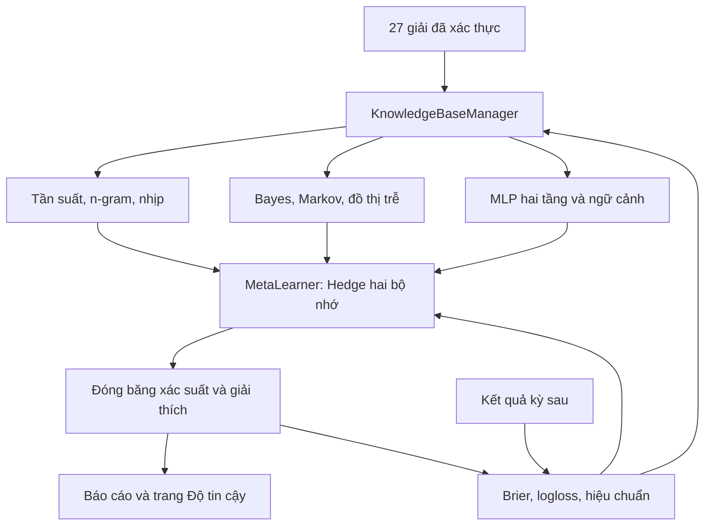

# XSMB: điều phối ba tác tử và tự học

## 1. Luồng dữ liệu

Đặc tả của chủ dự án ngày 17-10-2026 là phạm vi triển khai. Chỉ XSMB, hai mục tiêu
`de` (đuôi Đặc Biệt, categorical 100 lớp) và `loto` (có mặt ít nhất một lần,
100 biên Bernoulli). Giữ sổ và hợp đồng công bố đang có. Triển khai trên nhánh
riêng của bản clone sạch; kiểm thử trước khi cập nhật main/public theo ủy quyền
đã có trong chuỗi công việc.



## 2. Các thành phần và giới hạn

- `KnowledgeBaseManager`: tái sử dụng `knowledge_base.ContextMemory` và kho luật
  đã đăng ký. Tần suất 10/30 kỳ là trí nhớ ngắn; vectơ cosine và luật là trí nhớ
  dài. Ngữ cảnh láng giềng bỏ 30 kỳ chồng cửa sổ. Kết quả cũ không trở thành
  dự báo tiến cứu. Luật mô tả chưa có bằng chứng không được cộng xác suất.
- `AlgorithmEnsemble`: ba tác tử nhận cùng tiền tố lịch sử. Thống kê dùng
  tiên nghiệm Beta/Dirichlet, n-gram nhị phân và hazard theo số kỳ từ lần về.
  Đồ thị có hướng là P(b ở kỳ kế | a vừa về), co Bayes theo số hỗ trợ;
  Markov dùng trạng thái hiện tại của từng con. Pattern dùng MLP hai tầng
  ẩn (24, 12), đặc trưng trước kỳ đích, chọn regularization trên khối sau
  theo thời gian, không random split. Không gọi biến động xổ số là thị trường.
- `MetaLearner`: dùng chính lõi `online_learning`, profile riêng với ba tác tử,
  đương nhiệm và hằng số; không viết lại Hedge/settlement/lock/checksum.
  Sổ profile mới không sửa hoặc chấm lại sổ bảy chuyên gia cũ. Trọng số học
  trên Brier; đánh giá cả logloss. η và độ quên được chọn bằng replay tiến
  tuần tự chỉ trên các dự báo đã đóng băng và có kết quả.
- `PredictiveEngine`: nhận xác suất sản xuất thật làm đối chứng, chốt một lần
  trước 18:00 ICT, cập nhật sau kết quả thật; ghi nguyên tử dưới khóa. Sửa
  lịch sử, sai ngày, dữ liệu tương lai hoặc sổ hỏng làm dừng sạch.

Profile mới vận hành **shadow**: mọi tác tử được chạy và tự học nhưng không
ghi đè vector công bố của pipeline. Cổng hiện tại là đối chứng thực nghiệm,
không phải bằng chứng tuần tự cho phép tự ý đưa mô hình mới vào sản xuất.
Đề bạt cần thắng hằng số và đương nhiệm, qua benchmark hiện hữu và kiểm tiến
cứu mới. Trang công bố phân biệt xác suất thật với xác suất ứng viên.

## 3. Toán học và giải thích

Với Brier ℓ, L dài = Σℓ, L ngắn = Σγ^(t-s)ℓ. Với từng bộ nhớ,
q_e = softmax(-η L_e); w_e = (1-ε)(q_dài+q_ngắn)/2 + ε/E.
η ∈ {1,4,8}, γ ∈ {0.90,0.97}; chọn cấu hình có Brier replay thấp nhất,
chỉ sau ít nhất 30 kết quả thật. Chưa đủ mẫu dùng η=4, γ=0.97.

Hỗn hợp p = Σw_e p_e. Mỗi con có căn cứ tính toán kiểm tra được:
nền + Σw_e(p_e-nền) = p. Đây là vết chứng cứ, không phải dòng suy nghĩ nội
bộ. `hit_probability_percent` = 100p; không diễn giải như xác suất mô hình
đúng. Sai số hiệu chuẩn chỉ được ước lượng khi đủ ngày chấm, với SE khối
7 kỳ. Thiếu mẫu trả null, không tự gán 90% hay 95% độ tin cậy.

## 4. Vận hành và mở rộng

Mã chạy thật nằm trong `src/xsmb_agents/`, xuất bốn lớp yêu cầu:
`KnowledgeBaseManager`, `AlgorithmEnsemble`, `MetaLearner`, `PredictiveEngine`.

```python
from pathlib import Path
from xsmb_agents import PredictiveEngine

report = PredictiveEngine().run(Path("data"))
for mode, result in report["modes"].items():
    print(mode, result["weights"], result["candidate_top5"])
```

Chạy độc lập: `PYTHONPATH=src python src/run_xsmb_agents.py`. Pipeline chính
tự gọi sau khi đủ dự báo sản xuất hai mục tiêu. Tác tử lấy snapshot sau chấm xác suất, chẩn đoán và cập nhật
kho tri thức của cùng lượt; chỉ bước dựng HTML chạy sau snapshot. Đọc kết quả
trong `data/agents/report.json`; sổ có checksum ở
`data/online/agents_de.json` và `data/online/agents_loto.json`. Trang
`do-tin-cay.html#app-agents` có nút tải toàn bộ 100 số mỗi mục tiêu. Những
tác vụ tính trên CPU chạy tuần tự, không dùng async để giả tăng tốc.

Kiểm hồi cứu tái lập: `PYTHONPATH=src OPENBLAS_NUM_THREADS=1 python
src/run_xsmb_agents.py --benchmark-last 60`. Kết quả nằm trong
`data/agents/benchmark.json`, có fingerprint đầu vào, cỡ mẫu, Brier/logloss
từng tầng và đối chứng. Tệp ghi rõ `prospective_draws=0`, không ghi bất kỳ
sổ dự báo nào và không được dùng để tự đề bạt.

Python 3.11, NumPy, pandas, scikit-learn; dùng JSON có checksum, khóa POSIX,
ghi nguyên tử và vectơ cosine tại chỗ, phù hợp GitHub Actions/Pages hiện tại.
Khi có nhiều miền/dữ liệu hơn, có thể thay adapter trí nhớ bằng pgvector hoặc
Qdrant, đồ thị bằng Neo4j; không cần dịch vụ mới cho 100 số hiện tại.

Chống học vẹt: tiền tố thời gian, kiểm hậu tố, co Bayes, L2, giới hạn cửa sổ
học, so hằng số/đương nhiệm, điểm dự báo thật, không chọn trên kết quả đích,
và giữ các lần thua trong sổ. Không thuật toán nào đảm bảo dự đoán được kỳ
quay công bằng. Kiểm hồi cứu chỉ là chẩn đoán, không cộng vào bằng chứng tiến cứu.
