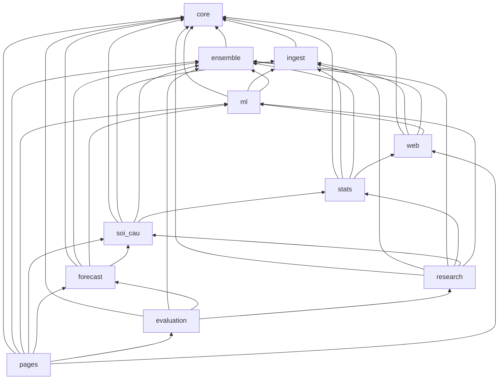

# Bố cục `src/`: gói con theo chức năng (23-10-2026)

Đây là đợt 2 của việc sắp xếp kho; đợt 1 (13-10-2026) tách `docs/` khỏi `documentation/` và chia
nhóm `scripts/`. Trước đợt này, `src/` có 145 module ngang hàng: `ui_theme` nằm cạnh `sources`,
`meta_predictor`, `hot_tail_test`. Đọc tên tệp không cho biết nó thuộc tầng nào, và không gì ngăn
một module thống kê import một trình dựng trang.

Nay gốc `src/` chỉ còn `pipeline.py`. 144 module còn lại nằm trong gói, **tên module giữ nguyên**,
chỉ thêm tiền tố gói. Vì thế:

- nhãn đã ghi vào sổ (`calendar_alignment.known_non_draw_days` trong sổ học trực tuyến,
  `number_reference.cap_loto_50_partner` trong nhóm đặc trưng) vẫn đúng;
- mọi chỗ CLAUDE.md và tài liệu nhắc `module.hàm` vẫn đúng.

## Các gói

| Gói | Chức năng | Module |
|---|---|---|
| `core` | Miền XSMB, lịch quay, đồng hồ, mã số, I/O nguyên tử, đường dẫn kho. Gói đáy: không import gói nào khác. | atomic_io, calendar_alignment, dtos, excel_export, lottery_codes, model_io, number_reference, path_models, paths, resilience, safe_io, time_policy, xsmb_domain |
| `ingest` | Thu thập, đối chiếu, lưu kết quả quay; kiểm dữ liệu | backfill_history, fetch, fetch_results, live_sync, lottery, reconcile_live_canonical, regional_lottery, sources, sync, validate_data, validate_excel_integrity |
| `ensemble` | Nguyên liệu tổ hợp xác suất: neo mức, trọng số, thành phần, hiệu chỉnh, gộp ý kiến, co ngót, đa dạng đuôi | calibration, ensemble_components, ensemble_utils, hierarchical_pooling, learn_ensemble_weights, opinion_pool, pick_diversity |
| `stats` | Thống kê mô tả và kiểm định, ma trận, tín hiệu thống kê | advanced_stats, analyze, cap_loto_50_stats, conditional_matrices, cycle_stats, descriptive_extensions, export_number_reference, frequency_stats, gap_cycle_stats, hazard_stats, markov_stats, normalize_pair_artifacts, number_dynamics, pair_stats, plot_utils, randomness_battery, significance_stats, statistical_corrections, statistical_matrices, statistical_signal, statistics_ai_overlay |
| `soi_cau` | Cầu vị trí, bảy kiểu cầu, cầu theo đường, tổng – bóng – chạm; gói con `bridges` (quét cầu ghép chéo ngày, cổng kiểm định, `run_bridge_scan`) và `features` (đặc trưng soi cầu cho mô hình) | bridge_rules, cau_position_evidence, digit_sum_rules, dynamic_cau, path_prob, path_timeline_evidence, position_bridges, run_path_ui; bridges/{firewall, replication, run_bridge_scan, scanner, shadow, spec, tensor}; features/{base, double_hit, geometric, pattern_memory, registry, special_set} |
| `ml` | ML thành phần và Cầu Kèo | cau_keo_daily_top, cau_keo_domain_challenger, cau_keo_feature_groups, cau_keo_ml, ml_features, ml_models, ml_predict, ml_train, ml_validation, validate_cau_keo_domain |
| `forecast` | Dự báo kỳ tới: xếp chồng, dự báo đầy đủ, học trực tuyến, kho tri thức, Lô VIP; gói con `modeling` (gói dự đoán hằng ngày `predictions_today.json`: xếp chồng, giải thích Shapley, lọc rủi ro) và `xsmb_agents` (hệ ba tác tử XSMB, bước pipeline) | daily_forecast, feature_attribution, knowledge_base, meta_predictor, multi_hit_benchmark, multi_hit_forecast, multi_hit_pairs, multi_hit_report, multi_hit_vip, online_learning, predict_nextday_2d; modeling/{benchmark, bundle, explain, risk, run_daily_prediction, stacking}; xsmb_agents/{algorithms, benchmark, engine, knowledge, run_xsmb_agents} |
| `evaluation` | Chấm và giám sát: chất lượng mô hình, sổ dự báo, độ tin cậy, bảng mô phỏng, kiểm toán vận hành | backfill_baseline_skill, check_baseline_skill, cleanup_artifacts, confidence_matrix, fun_draw_ledger, model_quality, monitor_health, prediction_board, prob_eval_history, production_audit, record_pred_history, skill_monitor, update_pred_labels |
| `research` | Phòng nghiên cứu và phép kiểm tiến cứu đã đăng ký; gói con `ml_engine` (khung học tiếp diễn) và `vla` (phòng thử thách mô hình), cả hai không nằm trong pipeline | bong_bridge_lab, conditional_nextday, crosslag_positional_lab, digit_sum_hypothesis, hot_tail_test, legacy_advanced_diagnostics, research_diagnostics, research_firewall, research_legacy_extensions, strategy_lab; ml_engine/{aggregation, capabilities, drift, fallback, features, main_pipeline, metrics, models, schema, selection, validation}; vla/{backtest, features, models} |
| `web` | Khung trang dùng chung; tài nguyên `templates` (mẫu HTML/CSS/JS, bộ nạp Jinja `Render`) và `assets` (tệp tĩnh chép sang `docs/assets`) | analysis_workspace, app_icons, app_shell, calendar_widget, crafto_design, critical_css_generated, css_links, dashboard_tables, draw_metadata, evidence_catalog, lab_ui, nexlink_icons, page_output, shared_results, site_assets, ui_locale, ui_page_refinements, ui_theme, web_security; templates/, assets/ |
| `pages` | Trình dựng từng trang trong `docs/`, cùng README | build_* (19 trình dựng), update_readme, vietlott_navigation_content |

Gói có sẵn từ trước đã gom hết (24-10-2026), gốc `src/` không còn gì đứng riêng:

- `crawler/fetch_results` → `ingest/fetch_results` (thăm dò tới khi đủ 27 ô);
- `utils/resilience` → `core/resilience` (thử lại có thoái lui, chỉ thư viện chuẩn nên ở được gói đáy);
- `bridges/` → `soi_cau/bridges/`, `features/` → `soi_cau/features/`, `modeling/` →
  `forecast/modeling/`, `xsmb_agents/` → `forecast/xsmb_agents/`, `ml_engine/` →
  `research/ml_engine/`, `vla/` → `research/vla/`. Các gói này giữ nguyên làm GÓI CON vì tên
  module của chúng chung chung (`base`, `spec`, `risk`, `bundle`, `engine`): trải phẳng thì phải
  đổi tên, mà tên module là thứ không đổi. `ml_engine` và `vla` không chạy trong pipeline, nên
  chúng ở `research`;
- `templates/` → `web/templates/`, `assets/` → `web/assets/`: tài nguyên của tầng trang nằm cạnh
  mã dùng chúng. Hai trình dựng (`build_docs`, `stats.analyze`) từng tự ghép
  `repo_root / "src" / "templates"`; nay chúng đọc `core.paths.TEMPLATES`.

`bridges` từng lấy `bh_fdr` từ `research.research_diagnostics`; vào `soi_cau` thì
`research → soi_cau → research` thành vòng. `bh_fdr` chỉ là lớp bọc của
`stats.statistical_corrections.benjamini_hochberg`, nên `bridges` nay lấy thẳng hàm ấy.

Ba lệnh chạy ở cạnh gói chúng điều khiển: `soi_cau/bridges/run_bridge_scan.py`,
`forecast/modeling/run_daily_prediction.py`, `forecast/xsmb_agents/run_xsmb_agents.py`.

Vài chỗ xếp đáng nói:

- `digit_sum_rules` ở `soi_cau`: đó là phương pháp soi cầu của chuyên mục bài dự đoán.
  Phép kiểm tiến cứu của nó, `digit_sum_hypothesis`, ở `research`.
- Cả họ `multi_hit_*` ở `forecast`, kể cả phép kiểm một lần `multi_hit_benchmark`. Bước
  `multi_hit_report` của production đọc nó, và tách một họ ra hai gói thì khó tìm.
- `draw_metadata` ở `web`: nó dùng bộ nạp kết quả của `calendar_widget`. Đặt ở `ingest` thì
  `ingest → web → ml → ingest` thành vòng.

## `scripts/`

`scripts/` chia theo chức năng từ đợt 1. Bảng nhóm là `SCRIPT_GROUPS` trong
`tests/repo/test_repo_layout.py`:

| Nhóm | Chức năng |
|---|---|
| `ops` | Vận hành CI và triển khai: báo động đường đúng giờ, chẩn đoán nguồn, xoá cache, đẩy trang dẫn xuất |
| `web` | Công cụ dựng và hậu xử lý trang đã xuất bản: critical CSS, khung điều hướng, CSP, DOM |
| `browser` | Kiểm trang đã xuất bản trên Chromium thật |
| `reference` | Đọc trang tham chiếu qua runner Actions |
| `release` | Bốn kịch bản chốt phát hành |
| `research` | Phép đo và benchmark tái lập được của tài liệu nghiên cứu |

Ngày 24-10-2026 bốn công cụ dựng trang (`extract_critical_css`, `refresh_navigation`,
`patch_csp_no_inline`, `optimize_index_dom`) tách khỏi `ops` sang `web`: chúng không vận hành
gì, chúng sinh lại tệp trong `docs/` và `src/web/critical_css_generated.py`. Mỗi script Python
phải có docstring nói nó làm gì; `research/path_backtest.py` là tệp duy nhất từng thiếu.

## `tests/`

Từ 24-10-2026, 213 tệp kiểm nằm trong `tests/<nhóm>/`. Nhóm được chọn theo gói `src/` mà
tệp import nhiều nhất (đo bằng AST), rồi sửa tay cho các tệp kiểm cắt ngang. Bảng nhóm là
`TEST_GROUPS` trong `tests/repo/test_repo_layout.py`.

| Nhóm | Chức năng | Tệp |
|---|---|---:|
| core … pages | 11 nhóm trùng tên gói `src/` mà phép kiểm kiểm | 178 |
| `pipeline` | thứ tự bước của `src/pipeline.py` | 3 |
| `site` | bất biến trên trang đã xuất bản trong `docs/` | 5 |
| `worker` | Worker Cloudflare (`worker/`) và phép so bản Python ↔ JS | 8 |
| `repo` | bố cục kho, workflow, CI, tài liệu, kịch bản vận hành, bảo mật cắt ngang | 19 |

Theo gói: `core` 8, `ingest` 18, `ensemble` 12, `stats` 26, `soi_cau` 11, `ml` 11, `forecast` 18, `evaluation` 10, `research` 15, `web` 31, `pages` 18.

Ràng buộc và các phép kiểm canh chúng:

- **Tên tệp duy nhất.** Tên tệp giữ nguyên và phải duy nhất toàn `tests/`: không có `__init__.py`,
  pytest nạp phép kiểm theo tên tệp.
- **Gốc kho.** Gốc kho là `Path(__file__).resolve().parents[2]`; `parents[1]` chỉ để tới
  `tests/fixtures`.
- **Helper dùng chung.** Helper dùng giữa các nhóm đặt ở gốc `tests/` với tên `*_helpers.py`.
  `LEAK_TOKENS` từng nằm trong một tệp kiểm của nhóm `site` mà hai nhóm khác import, nay nằm ở
  `privacy_helpers.py`.
- **Quét đệ quy.** Hai phép kiểm từng `glob("test_*.py")` ở gốc `tests/`: sau đợt chuyển chúng quét
  tập rỗng và vẫn xanh. Nay chúng dùng `rglob` và đòi tập không rỗng.
- **Đường dẫn có thật.** Mọi đường dẫn `tests/…py` được nhắc trong kho phải trỏ tệp có thật (cùng luật
  với `scripts/…`). Luật này bắt ngay hai tài liệu còn nhắc phép kiểm đã gỡ từ trước.

Kiểm chứng: `pytest --collect-only` thu đúng 3 930 phép kiểm, cùng ID trước và sau khi chuyển.

## `documentation/`

Tài liệu chia theo CHỨC NĂNG của chính nó, không theo mảng mã: `architecture`, `operations`,
`research`, `plans`, `qa`, `engineering-log`, `history`. Bảng nhóm là bảng "Bố cục thư mục" trong
`documentation/README.md`.

Ngày 24-10-2026, ba thư mục lệch trục được trả về nhóm chức năng:

- `ui/` chia theo loại tài liệu: đặc tả và hệ thiết kế về `architecture/`, báo cáo và số đo về
  `qa/`, nhật ký tiến độ về `history/`;
- `domain/` (quan hệ số chuẩn là hợp đồng) về `architecture/`;
- `evaluations/` về `qa/evaluations/`.

Hai kế hoạch nằm nhầm trong `architecture/` về `plans/`.

Liên kết tương đối được giải theo vị trí cũ của cả tệp nguồn lẫn tệp đích, rồi viết lại theo vị
trí mới. Các phép kiểm canh:

- `test_documentation_index` buộc bảng khớp thư mục thật và mọi liên kết trong mọi tài liệu sống;
- `test_repo_layout` buộc mọi đường dẫn `documentation/…` nhắc trong kho có tệp.

## Phụ thuộc giữa các gói

Đồ thị dưới đây là đồ thị THẬT, đo bằng AST trên mọi import, kể cả import trễ trong hàm. Nó
không có vòng; `tests/repo/test_src_layout.py` làm đỏ ngay khi có vòng.

`stats → web` là `stats.analyze` dựng README bằng bộ nạp mẫu `web.templates.Render`.

## Luật

- **Import.** Viết `from ensemble import ensemble_utils` hoặc
  `from ensemble.ensemble_utils import finalize_blend`. Import theo tên phẳng cũ chỉ chạy được
  khi kịch bản đứng cùng thư mục với module ấy.
- **Chạy.** Dùng `PYTHONPATH=src python src/<gói>/<module>.py`. Chạy bằng đường dẫn tệp thì
  Python đặt thư mục của chính tệp (`src/<gói>`) lên `sys.path`, không phải `src`.
  - `pipeline._child_env` đặt `src` lên đầu `PYTHONPATH` cho mọi bước con.
  - Mọi job workflow chạy `src/<gói>/…` khai `PYTHONPATH` trong `env`. Năm job từng dựa vào
    việc kịch bản nằm ngay trong `src/`:
    - `dashboard-refresh`
    - `pages`
    - `post-finalization`
    - `watchdog`
    - `update-data/deploy-pages`
- **Đường dẫn.** Gốc kho, `src/web/templates` và `src/web/assets` chỉ lấy qua `core.paths`
  (`REPO_ROOT`, `SRC`, `TEMPLATES`, `ASSETS`). Trước đợt gom có 48 dòng tính
  đường dẫn từ `Path(__file__)` tại chỗ.
  - Chỗ nguy hiểm nhất là `calendar_alignment.known_non_draw_days`: sai tầng thì lịch ngày
    nghỉ rỗng, không báo lỗi.
  - Một phép kiểm vá `regional_lottery.__file__` để đổi gốc kho. Sau khi chuyển, nó ghi thẳng
    vào `data/regions/` thật; lỗi bắt được khi chạy thử và đã sửa sang vá `REPO_ROOT`.
- **Pack joblib cũ.** Năm pack trong `models/` nhắc lớp `PlattCalibratedClassifier` bằng tên
  module phẳng `ml_models`. `ml/ml_models.py` đăng ký tên ấy trong `sys.modules`.
  - Thiếu nó, unpickle ném `ImportError`; `MODEL_LOAD_ERRORS` bắt lỗi ấy, và bước dự báo coi
    pack là hỏng mà không báo.
  - Pack ghi sau đợt gom nhắc `ml.ml_models`.
- **Module mới** vào gói đúng chức năng, không đặt ở gốc `src/`.

## Cách chuyển và cách kiểm

Việc chuyển làm bằng máy, không sửa tay từng tệp:

- `git mv` từng module;
- viết lại import bằng AST;
- viết lại đường dẫn `src/<x>.py` trong workflow, kịch bản, test, tài liệu, chú thích JS của
  worker;
- viết lại mã Python nằm trong chuỗi (`python -c '…'` trong workflow, shell, kiểm thử Node).

Kịch bản chuyển là việc một lần nên không commit.

Kiểm chứng:

- bộ kiểm Python, bộ kiểm frontend, `ruff`, bốn kịch bản chốt phát hành;
- chạy **pipeline đầy đủ** (`--skip-sync --strict`) trên `main` và trên bản đã chuyển, cùng dữ
  liệu đầu vào, rồi so mọi tệp đầu ra. Kết quả ghi trong PR.

`tests/repo/test_src_layout.py` canh các luật trên:

- gốc `src/` chỉ có `pipeline.py`;
- mọi gói có docstring;
- không import theo tên phẳng, kể cả trong workflow, shell và kiểm thử Node;
- gói không vòng;
- đường dẫn chỉ qua `core.paths`;
- lịch ngày nghỉ đọc được;
- job workflow có `PYTHONPATH`;
- mọi lệnh chạy `src/…py` trong workflow, `scripts/` và `pipeline.py` trỏ tệp có thật, và tên gói đã
  gom (`crawler`, `utils`, `bridges`, `features`, `modeling`, `ml_engine`, `vla`, `xsmb_agents`,
  `templates`) không còn được import;
- bộ lọc `paths:` của workflow khớp tệp có thật;
- trong `src/`, chỉ `core/paths.py` ghép đường dẫn lên `SRC` hay `"src"`;
- mọi nơi nạp pack đọc được pack đã commit trong một tiến trình mới.

Mỗi luật được ghim trên mẫu dựng sẵn, để một phép quét rỗng không thể xanh.
