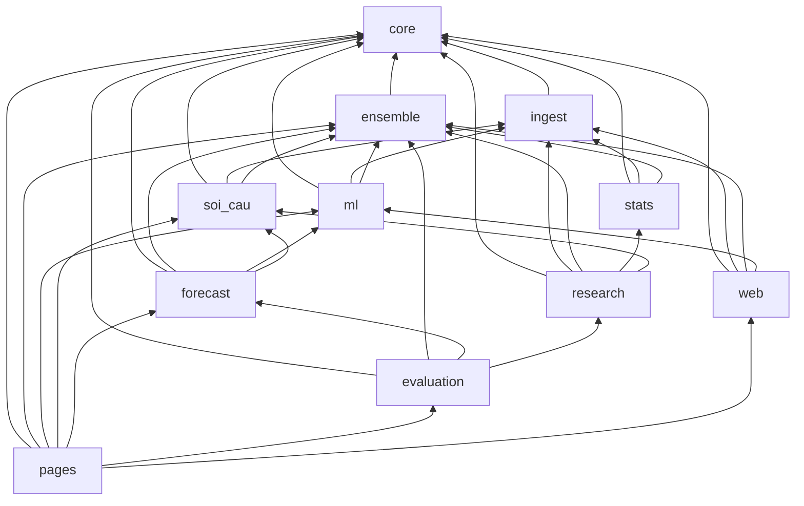

# Bố cục `src/`: gói con theo chức năng (23-10-2026)

Đây là đợt 2 của việc sắp xếp kho; đợt 1 (13-10-2026) tách `docs/` khỏi `documentation/` và chia
nhóm `scripts/`. Trước đợt này, `src/` có 145 module ngang hàng: `ui_theme` nằm cạnh `sources`,
`meta_predictor`, `hot_tail_test`. Đọc tên tệp không cho biết nó thuộc tầng nào, và không gì ngăn
một module thống kê import một trình dựng trang.

Nay gốc `src/` chỉ còn `pipeline.py`. 144 module còn lại nằm trong gói, **tên module giữ nguyên**,
chỉ thêm tiền tố gói. Vì thế:

- nhãn đã ghi vào sổ (`calendar_alignment.known_non_draw_days` trong sổ học trực tuyến,
  `number_reference.cap_loto_50_partner` trong nhóm đặc trưng) vẫn đúng;
- mọi chỗ CLAUDE.md và tài liệu nhắc `module.hàm` vẫn đúng.

## Các gói

| Gói | Chức năng | Module |
|---|---|---|
| `core` | Miền XSMB, lịch quay, đồng hồ, mã số, I/O nguyên tử, đường dẫn kho. Gói đáy: không import gói nào khác. | atomic_io, calendar_alignment, dtos, excel_export, lottery_codes, model_io, number_reference, path_models, paths, resilience, safe_io, time_policy, xsmb_domain |
| `ingest` | Thu thập, đối chiếu, lưu kết quả quay; kiểm dữ liệu | backfill_history, fetch, fetch_results, live_sync, lottery, reconcile_live_canonical, regional_lottery, sources, sync, validate_data, validate_excel_integrity |
| `ensemble` | Nguyên liệu tổ hợp xác suất: neo mức, trọng số, thành phần, hiệu chỉnh, gộp ý kiến, co ngót, đa dạng đuôi | calibration, ensemble_components, ensemble_utils, hierarchical_pooling, learn_ensemble_weights, opinion_pool, pick_diversity |
| `stats` | Thống kê mô tả và kiểm định, ma trận, tín hiệu thống kê | advanced_stats, analyze, cap_loto_50_stats, conditional_matrices, cycle_stats, descriptive_extensions, export_number_reference, frequency_stats, gap_cycle_stats, hazard_stats, markov_stats, normalize_pair_artifacts, number_dynamics, pair_stats, plot_utils, randomness_battery, significance_stats, statistical_corrections, statistical_matrices, statistical_signal, statistics_ai_overlay |
| `soi_cau` | Cầu vị trí, bảy kiểu cầu, cầu theo đường, tổng – bóng – chạm | bridge_rules, cau_position_evidence, digit_sum_rules, dynamic_cau, path_prob, path_timeline_evidence, position_bridges, run_path_ui |
| `ml` | ML thành phần và Cầu Kèo | cau_keo_daily_top, cau_keo_domain_challenger, cau_keo_feature_groups, cau_keo_ml, ml_features, ml_models, ml_predict, ml_train, ml_validation, validate_cau_keo_domain |
| `forecast` | Dự báo kỳ tới: xếp chồng, dự báo đầy đủ, học trực tuyến, kho tri thức, Lô VIP | daily_forecast, feature_attribution, knowledge_base, meta_predictor, multi_hit_benchmark, multi_hit_forecast, multi_hit_pairs, multi_hit_report, multi_hit_vip, online_learning, predict_nextday_2d |
| `evaluation` | Chấm và giám sát: chất lượng mô hình, sổ dự báo, độ tin cậy, bảng mô phỏng, kiểm toán vận hành | backfill_baseline_skill, check_baseline_skill, cleanup_artifacts, confidence_matrix, fun_draw_ledger, model_quality, monitor_health, prediction_board, prob_eval_history, production_audit, record_pred_history, skill_monitor, update_pred_labels |
| `research` | Phòng nghiên cứu và phép kiểm tiến cứu đã đăng ký | bong_bridge_lab, conditional_nextday, crosslag_positional_lab, digit_sum_hypothesis, hot_tail_test, legacy_advanced_diagnostics, research_diagnostics, research_firewall, research_legacy_extensions, strategy_lab |
| `web` | Khung trang dùng chung | analysis_workspace, app_icons, app_shell, calendar_widget, crafto_design, critical_css_generated, css_links, dashboard_tables, draw_metadata, evidence_catalog, lab_ui, nexlink_icons, page_output, shared_results, site_assets, ui_locale, ui_page_refinements, ui_theme, web_security |
| `pages` | Trình dựng từng trang trong `docs/`, cùng README | build_* (19 trình dựng), update_readme, vietlott_navigation_content |

Gói có sẵn từ trước giữ nguyên: `bridges`, `features`, `ml_engine`, `modeling`, `vla`,
`xsmb_agents`, `templates`. Hai gói một-module cũ đã được gom (24-10-2026): `crawler/fetch_results`
→ `ingest/fetch_results` (thăm dò tới khi đủ 27 ô), `utils/resilience` → `core/resilience`
(thử lại có thoái lui, chỉ dùng thư viện chuẩn nên ở được gói đáy). Ba lệnh chạy về ở cạnh gói
chúng điều khiển:

- `run_bridge_scan` → `bridges/`
- `run_daily_prediction` → `modeling/`
- `run_xsmb_agents` → `xsmb_agents/`

Đặt ba lệnh này ở `forecast` hay `soi_cau` thì `forecast ↔ xsmb_agents` và
`research → soi_cau → bridges → research` thành vòng.

Vài chỗ xếp đáng nói:

- `digit_sum_rules` ở `soi_cau`: đó là phương pháp soi cầu của chuyên mục bài dự đoán.
  Phép kiểm tiến cứu của nó, `digit_sum_hypothesis`, ở `research`.
- Cả họ `multi_hit_*` ở `forecast`, kể cả phép kiểm một lần `multi_hit_benchmark`. Bước
  `multi_hit_report` của production đọc nó, và tách một họ ra hai gói thì khó tìm.
- `draw_metadata` ở `web`: nó dùng bộ nạp kết quả của `calendar_widget`. Đặt ở `ingest` thì
  `ingest → web → ml → ingest` thành vòng.

## Phụ thuộc giữa các gói

Đồ thị dưới đây là đồ thị THẬT, đo bằng AST trên mọi import, kể cả import trễ trong hàm. Nó
không có vòng; `tests/test_src_layout.py` làm đỏ ngay khi có vòng.

Các gói cũ cũng nằm trong đồ thị:

- `bridges` → `core`, `research`
- `xsmb_agents` → `core`, `ensemble`, `ml`, `forecast`
- `vla` → `core`, `ml`, `soi_cau`

## Luật

- **Import.** Viết `from ensemble import ensemble_utils` hoặc
  `from ensemble.ensemble_utils import finalize_blend`. Import theo tên phẳng cũ chỉ chạy được
  khi kịch bản đứng cùng thư mục với module ấy.
- **Chạy.** Dùng `PYTHONPATH=src python src/<gói>/<module>.py`. Chạy bằng đường dẫn tệp thì
  Python đặt thư mục của chính tệp (`src/<gói>`) lên `sys.path`, không phải `src`.
  - `pipeline._child_env` đặt `src` lên đầu `PYTHONPATH` cho mọi bước con.
  - Mọi job workflow chạy `src/<gói>/…` khai `PYTHONPATH` trong `env`. Năm job từng dựa vào
    việc kịch bản nằm ngay trong `src/`:
    - `dashboard-refresh`
    - `pages`
    - `post-finalization`
    - `watchdog`
    - `update-data/deploy-pages`
- **Đường dẫn.** Gốc kho, `src/templates` và `src/assets` chỉ lấy qua `core.paths`
  (`REPO_ROOT`, `SRC`, `TEMPLATES`, `ASSETS`). Trước đợt gom có 48 dòng tính
  đường dẫn từ `Path(__file__)` tại chỗ.
  - Chỗ nguy hiểm nhất là `calendar_alignment.known_non_draw_days`: sai tầng thì lịch ngày
    nghỉ rỗng, không báo lỗi.
  - Một phép kiểm vá `regional_lottery.__file__` để đổi gốc kho. Sau khi chuyển, nó ghi thẳng
    vào `data/regions/` thật; lỗi bắt được khi chạy thử và đã sửa sang vá `REPO_ROOT`.
- **Pack joblib cũ.** Năm pack trong `models/` nhắc lớp `PlattCalibratedClassifier` bằng tên
  module phẳng `ml_models`. `ml/ml_models.py` đăng ký tên ấy trong `sys.modules`.
  - Thiếu nó, unpickle ném `ImportError`; `MODEL_LOAD_ERRORS` bắt lỗi ấy, và bước dự báo coi
    pack là hỏng mà không báo.
  - Pack ghi sau đợt gom nhắc `ml.ml_models`.
- **Module mới** vào gói đúng chức năng, không đặt ở gốc `src/`.

## Cách chuyển và cách kiểm

Việc chuyển làm bằng máy, không sửa tay từng tệp:

- `git mv` từng module;
- viết lại import bằng AST;
- viết lại đường dẫn `src/<x>.py` trong workflow, kịch bản, test, tài liệu, chú thích JS của
  worker;
- viết lại mã Python nằm trong chuỗi (`python -c '…'` trong workflow, shell, kiểm thử Node).

Kịch bản chuyển là việc một lần nên không commit.

Kiểm chứng:

- bộ kiểm Python, bộ kiểm frontend, `ruff`, bốn kịch bản chốt phát hành;
- chạy **pipeline đầy đủ** (`--skip-sync --strict`) trên `main` và trên bản đã chuyển, cùng dữ
  liệu đầu vào, rồi so mọi tệp đầu ra. Kết quả ghi trong PR.

`tests/test_src_layout.py` canh các luật trên:

- gốc `src/` chỉ có `pipeline.py`;
- mọi gói có docstring;
- không import theo tên phẳng, kể cả trong workflow, shell và kiểm thử Node;
- gói không vòng;
- đường dẫn chỉ qua `core.paths`;
- lịch ngày nghỉ đọc được;
- job workflow có `PYTHONPATH`;
- mọi lệnh chạy `src/…py` trong workflow, `scripts/` và `pipeline.py` trỏ tệp có thật, và tên gói đã
  gom (`crawler`, `utils`) không còn được import;
- mọi nơi nạp pack đọc được pack đã commit trong một tiến trình mới.

Mỗi luật được ghim trên mẫu dựng sẵn, để một phép quét rỗng không thể xanh.
