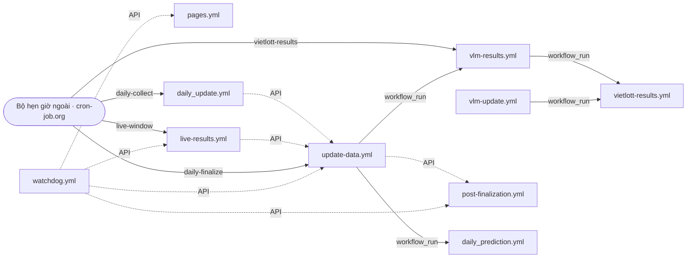

# Bản đồ workflow — mắt xích, thứ tự và điều kiện (01-11-2026)

27 workflow của kho nối nhau thành bốn chuỗi. Tài liệu này nói chuỗi nào chạy khi nào, bước nào
chờ bước nào, và phép kiểm nào giữ cho mắt xích không gãy lặng lẽ. Bảng và sơ đồ ở cuối được
DỰNG TỪ YAML bằng `python3 scripts/ops/workflow_map.py --write`; `tests/repo/test_workflow_map.py`
làm đỏ khi chúng lệch workflow thật. Giờ ghi theo giờ Việt Nam (UTC+7); cron trong YAML là UTC.
Lịch chi tiết từng mốc và lý do: [`scheduling.md`](scheduling.md), bộ hẹn giờ ngoài:
[`on-time-trigger.md`](on-time-trigger.md).

## 1. Chuỗi XSMB hằng ngày

| Bước | Giờ VN | Workflow | Việc làm | Bước kế |
|---|---|---|---|---|
| 1 | 18:05 | `live-results.yml` (`live-window`) | Thăm dò kết quả trong khung quay, ghi bản live | gọi `update-data.yml` khi đủ ô |
| 2 | 18:10 | `daily_update.yml` (`daily-collect`) | Thu thập đúng giờ, đối chiếu nguồn chính/dự phòng | gọi `update-data.yml` |
| 3 | 18:35 | `update-data.yml` (`daily-finalize`) | `canonical` chốt và commit kết quả chuẩn → song song `publish-results` (trang chủ, sổ kết quả, soi cầu vị trí) và `update` (pipeline đầy đủ) → `deploy-pages` chờ cả hai → `verify-published-pages` | gọi `post-finalization.yml`; mở `daily_prediction.yml` và `vlm-results.yml` |
| 4 | sau 3 | `post-finalization.yml` | Kiểm toán sau hoàn tất, đối soát trực tiếp | — |
| 5 | sau 3 | `daily_prediction.yml` | Dự đoán hằng ngày (dự phòng cho bước 3) | — |
| ↺ | 17:55–20:05 và 07:15 | `watchdog.yml` | Thấy bước nào trễ hay hỏng thì gọi lại đúng workflow ấy (`live-results`, `update-data`, `post-finalization`, `pages`), bỏ qua nếu nó đang chạy | — |

Ba mốc 18:05 / 18:10 / 18:35 do bộ hẹn giờ ngoài gửi (`repository_dispatch`). Cron của GitHub chỉ là
lưới dự phòng: đo trên 32 mốc, nó trễ trung vị 4 giờ 04 phút. Nhiều đường cùng dẫn vào
`update-data.yml` có chủ đích. Nhóm `concurrency: daily-xsmb-pipeline` (không huỷ lượt đang chạy)
giữ tối đa một lượt chạy và một lượt chờ; lượt chờ mới thay lượt chờ cũ, nên kích hoạt trùng không
chạy chồng.

Trên trang Actions, lượt chờ bị thay hiện là `cancelled` với **0 job**: đó không phải lỗi, cũng không mất
việc, vì `update-data.yml` chỉ nhận tham số `reason` và tự xác định việc cần làm từ dữ liệu trên `main`.
`daily_update.yml` (nhóm `daily-xsmb-collect`) cũng vậy: lượt cron đến trước giữ nhóm và CHỜ trong runner
tới khung quay, các lượt đến sau xếp hàng và thay nhau. Ví dụ ngày 31-10-2026: lượt 06:56 UTC giữ nhóm và
xong 11:32 UTC; năm lượt đến lúc 07:34 → 10:36 UTC bị thay (0 job); lượt 10:59 UTC chạy sau và xanh.
Đáng lo chỉ là lượt `cancelled` CÓ job đã chạy (job quá `timeout-minutes`).

## 2. Chuỗi Vietlott

| Bước | Khi nào | Workflow | Việc làm | Bước kế |
|---|---|---|---|---|
| 1 | mỗi 10 phút 06:00–22:50, ban đêm mỗi giờ; `vietlott-results` sau từng khung quay; sau bước 3 của XSMB | `vlm-results.yml` | Cập nhật sản phẩm đến hạn (Keno/Bingo18 qua cổng hồ sơ bản sao từ 01-11-2026), chấm dự báo cũ, ghi dự báo kỳ sau, lưu sổ vào `main` qua `persist_site.py` | mở `vietlott-results.yml` |
| 1′ | 10:10 và 22:40 | `vlm-update.yml` | Cập nhật đầy đủ dữ liệu, dự báo, trang engine | mở `vietlott-results.yml` |
| 2 | sau 1 hoặc 1′ | `vietlott-results.yml` | Dựng 8 trang Vietlott từ trạng thái engine (chỉ đọc cache). Chỉ commit khi NỘI DUNG đổi (`scripts/web/stamp_only_change.py`), rồi triển khai Pages | — |

## 3. Kết quả miền Trung, miền Nam

`regional-results.yml` chạy 20:25. Nó tự dựng trang, commit và triển khai Pages; không chuỗi nào chờ nó.

## 4. Cổng chất lượng và công cụ tay

- Mỗi push/PR chạy `ci.yml` (bộ kiểm VLA, trình duyệt, bốn kịch bản chốt phát hành) và `codeql.yml`.
  Thay đổi trong `vietlott/` chạy thêm `vlm-ci.yml`, kiểm Python sàn 3.11 lẫn bản đang chạy.
- `vlm-installer.yml` (hằng tuần) và `vlm-release.yml` (tag `vlm-v…`) chỉ dành cho engine.
- Chỉ chạy tay: `inspect-reference-*` (đọc trang tham chiếu qua runner), `diagnose-live-sources`,
  `backfill-history`, `cache-purge`, `dashboard-refresh`.

## 5. Bất biến đã có phép kiểm

| Mắt xích | Hỏng thế nào nếu sai | Phép kiểm |
|---|---|---|
| `workflow_run` theo TÊN workflow nguồn | gõ sai tên thì không bao giờ chạy, không báo lỗi | `test_workflow_map.py` |
| Gọi API theo TÊN TỆP workflow | đổi tên tệp là đứt; tệp đích phải khai `workflow_dispatch` | `test_workflow_map.py` |
| Không vòng kích hoạt | hai workflow gọi nhau chạy mãi | `test_workflow_map.py` |
| Phiên bản Python một nguồn (`.python-version`) | bước ghim tay trôi khỏi bản khác | `test_python_version.py` |
| Bản ghim `gói==x` viết thẳng trong workflow trùng `requirements*.txt` | bản cũ không có bánh xe cho Python mới, hỏng ở bước cài | `test_python_version.py` |
| Bộ lọc `paths:` trỏ tệp có thật | workflow thôi chạy lặng lẽ | `test_workflows.py` |
| Workflow cài đủ thư viện mà script của nó import | hỏng khi chạy thật | `test_workflows.py` |
| Điều kiện `if:` của các job hoàn tất | trang chủ chờ pipeline hoặc bỏ triển khai | `test_finalization_timing.py` |
| Khối `run:` là mã | lỗi hệ bát phân, vòng thử lại kẹt | `test_workflow_shell_behaviour.py` |

## 6. Sơ đồ và bảng (dựng tự động)

Mũi tên liền: `workflow_run` hoặc sự kiện của bộ hẹn giờ ngoài. Mũi tên chấm: gọi API theo tên tệp.
Workflow không nối với workflow nào chỉ hiện trong bảng.

<!-- workflow-map:start -->

| Workflow | Tên | Kích hoạt | Kích hoạt tiếp | Ghi `main` | Triển khai Pages |
| --- | --- | --- | --- | --- | --- |
| `backfill-history.yml` | Bổ sung lịch sử KQXS | workflow_dispatch | — | có | — |
| `cache-purge.yml` | Xóa cache Actions | push (2 bộ lọc đường dẫn); workflow_dispatch | — | — | — |
| `ci.yml` | Kiểm thử liên tục | push; pull_request; workflow_dispatch | — | — | — |
| `codeql.yml` | CodeQL Advanced | cron `43 15 * * 4`; push; pull_request | — | — | — |
| `daily_prediction.yml` | Dự đoán hằng ngày | cron `35 11 * * *`, `15 12 * * *`, `15 13 * * *`; sau «Hoàn tất XSMB, thống kê và AI/ML»; workflow_dispatch | — | có | — |
| `daily_update.yml` | Thu thập XSMB đúng giờ | cron `13 1 * * *`, `55 1 * * *`, `37 2 * * *`, `19 3 * * *`, `1 4 * * *`, `43 4 * * *`, `27 5 * * *`, `17 8 * * *`; hẹn giờ ngoài `daily-collect`; workflow_dispatch | `update-data.yml` (API) | — | — |
| `dashboard-refresh.yml` | Làm mới bảng điều khiển Markdown | push (2 bộ lọc đường dẫn); workflow_dispatch | — | có | — |
| `diagnose-live-sources.yml` | Chẩn đoán nguồn live | workflow_dispatch | — | — | — |
| `inspect-reference-articles.yml` | Đọc bài phân tích của trang tham chiếu | workflow_dispatch | — | — | — |
| `inspect-reference-bridge.yml` | Đọc cách soi cầu của trang tham chiếu | workflow_dispatch | — | — | — |
| `inspect-reference-design.yml` | Đọc đặc tính thiết kế trang tham chiếu | workflow_dispatch | — | — | — |
| `inspect-reference-icons.yml` | Đo hệ biểu tượng và menu trang tham chiếu | workflow_dispatch | — | — | — |
| `inspect-reference-layout.yml` | Đo bố cục trang tham chiếu bằng trình duyệt | workflow_dispatch | — | — | — |
| `inspect-reference-pages.yml` | Đọc cấu trúc trang tham chiếu | workflow_dispatch | — | — | — |
| `inspect-reference-shell.yml` | Đo khung ứng dụng trang tham chiếu | workflow_dispatch | — | — | — |
| `live-results.yml` | Kết quả XSMB gần thời gian thực | cron `19 1 * * *`, `2 2 * * *`, `47 2 * * *`, `29 3 * * *`, `11 4 * * *`, `53 4 * * *`, `37 5 * * *`, `17 6 * * *`, `7 11 * * *`; hẹn giờ ngoài `live-window`; workflow_dispatch | `update-data.yml` (API) | có | — |
| `pages.yml` | Triển khai GitHub Pages | push (2 bộ lọc đường dẫn); workflow_dispatch | — | — | có |
| `post-finalization.yml` | Kiểm toán sau hoàn tất và đối soát trực tiếp | workflow_dispatch | — | có | — |
| `regional-results.yml` | Đồng bộ XSMT và XSMN | cron `25 13 * * *`; push (4 bộ lọc đường dẫn); workflow_dispatch | — | có | có |
| `update-data.yml` | Hoàn tất XSMB, thống kê và AI/ML | cron `33 11 * * *`, `41 11 * * *`, `53 11 * * *`, `7 12 * * *`, `19 12 * * *`, `27 12 * * *`, `39 12 * * *`, `51 12 * * *`, `9 13 * * *`; hẹn giờ ngoài `daily-finalize`; push (7 bộ lọc đường dẫn); workflow_dispatch | `post-finalization.yml` (API), `daily_prediction.yml` (workflow_run), `vlm-results.yml` (workflow_run) | có | có |
| `vietlott-results.yml` | Trang Vietlott (dựng từ engine) | cron `25 6 * * *`, `40 11 * * *`, `30 12 * * *`, `25 14 * * *`, `20 15 * * *`; sau «VLM · Tự cập nhật kết quả từng sản phẩm Vietlott», «VLM · Cập nhật dữ liệu, dự báo và trang Vietlott»; push (12 bộ lọc đường dẫn); workflow_dispatch | — | có | có |
| `vlm-ci.yml` | VLM · Kiểm thử engine Vietlott | push (6 bộ lọc đường dẫn); pull_request; workflow_dispatch | — | — | — |
| `vlm-installer.yml` | VLM · Bộ cài engine Vietlott | cron `25 2 * * 1`; push (8 bộ lọc đường dẫn); pull_request; workflow_dispatch | — | — | — |
| `vlm-release.yml` | VLM · Phát hành engine Vietlott | push | — | — | — |
| `vlm-results.yml` | VLM · Tự cập nhật kết quả từng sản phẩm Vietlott | cron `*/10 23,0-15 * * *`, `17 16-22 * * *`; hẹn giờ ngoài `vietlott-results`; sau «Hoàn tất XSMB, thống kê và AI/ML»; push (13 bộ lọc đường dẫn); workflow_dispatch | `vietlott-results.yml` (workflow_run) | có | — |
| `vlm-update.yml` | VLM · Cập nhật dữ liệu, dự báo và trang Vietlott | cron `40 15 * * *`, `10 3 * * *`; workflow_dispatch | `vietlott-results.yml` (workflow_run) | có | — |
| `watchdog.yml` | Giám sát và tự phục hồi production | cron `55 10 * * *`, `5 11 * * *`, `15 11 * * *`, `25 11 * * *`, `45 11 * * *`, `5 12 * * *`, `25 12 * * *`, `45 12 * * *`, `5 13 * * *`, `15 0 * * *`; workflow_dispatch | `live-results.yml` (API), `pages.yml` (API), `post-finalization.yml` (API), `update-data.yml` (API) | — | — |
<!-- workflow-map:end -->
